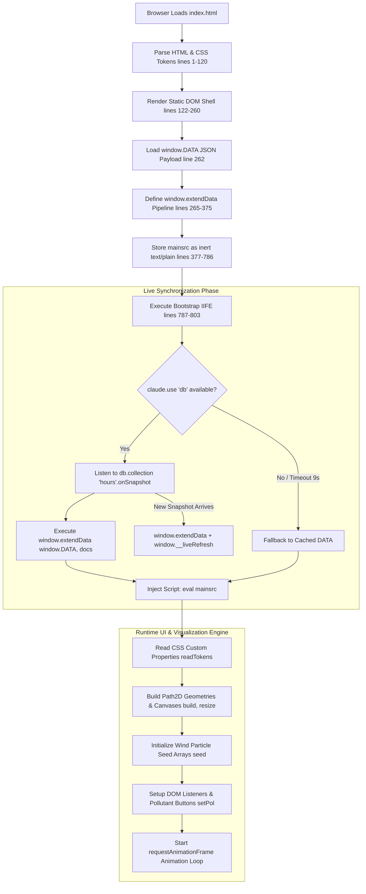
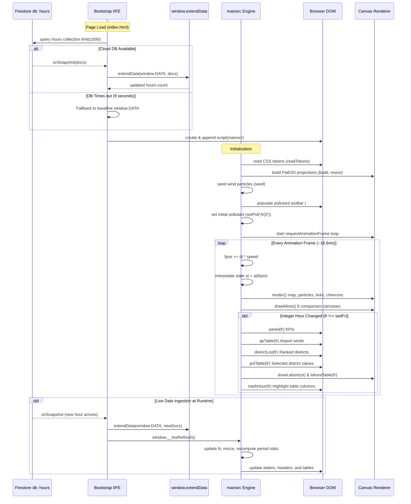

# Punjab Air Quality Information System
## Architecture, Monolithic Coupling, and UI/UX Component Analysis Report (R4 & R5)

**Author:** Architecture & UI Explorer (`teamwork_explorer`)  
**Target File Analyzed:** `c:\Users\Asif\Downloads\Punjab Air Quality\index.html`  
**Investigation Mode:** Read-Only Analysis (Zero Codebase Modifications)  
**Date:** November 10, 2026  

---

## 1. Executive Summary

A comprehensive architectural and UI/UX investigation was conducted on the authoritative application file `index.html` (9,609,848 bytes, 805 lines). The application is an air quality monitoring and meteorological visualization console for the Province of Punjab, Pakistan, tracking 79 monitoring stations across 41 districts, 6 international/military airports, 7 WMO synoptic stations, and ECMWF IFS regional wind grids over a 9-day hourly continuum (216 hours, November 1–9, 2026).

### Key Architectural Findings:
1. **Extreme Monolithic Single-File Bundling:** The entire application—including a 9.08 MB embedded JSON historical database (`window.DATA`), 375 KB of base64-encoded JPEG satellite figures, 49.2 KB of hardcoded GeoJSON boundary vectors (`GEO`), a complete client-side ETL/mathematical pipeline (`window.extendData`), an entire 103 KB custom canvas rendering and UI engine (`mainsrc`), and inline CSS—is packed into a single HTML file.
2. **Dynamic Multi-Stage Bootstrapping:** Application code is stored inertly as raw text inside a `<script id="mainsrc" type="text/plain">` element (lines 377–786). A bootstrap loader script (lines 787–803) queries a Claude environment Firestore-like database (`claude.use('db')`) for live hourly records, runs an inlined ETL engine to mutate the global data object, and dynamically creates and appends a executable `<script>` tag to start the UI.
3. **Severe Interleaving of Concerns:** Data ingestion, statistical quality control (QC), geospatial inverse distance weighting (IDW), flux calculations, transboundary index modeling, DOM manipulation, canvas-level pixel manipulation (`ImageData`), and a 60 FPS animation loop are completely interleaved across 60+ global variables without modular boundaries.
4. **Custom-Built Visualization Stack (Zero External Mapping Libraries):** Contrary to typical architectures employing Leaflet, Mapbox GL, D3, or Chart.js, this application implements a **custom, from-scratch 2D canvas visualization engine**, including equirectangular map projections, Path2D polygon rendering, a dual-layer wind particle advection system, quadratic Bezier animated transport curves, offscreen rasterized IDW continuous fields, polar CPF wind roses, and sparklines.
5. **High-Performance UI Coupled to Inefficient DOM Patterns:** While the canvas rendering leverages sub-hourly linear interpolation (`lerp`) and requestAnimationFrame, the UI layer relies on complete `innerHTML` string destruction and re-creation of hundreds of DOM elements on integer hour ticks, creating significant garbage collection pressure.

---

## 2. Current Client Architecture & Monolithic Single-File Coupling (Requirement R4)

### 2.1 File Anatomy & Byte Distribution

The 9.61 MB footprint of `index.html` is heavily dominated by inlined data payloads and media assets rather than markup or presentation logic:

| Line Range | Component Description | Size / Length | Architectural Role | Coupling / Concerns |
| :--- | :--- | :--- | :--- | :--- |
| **Lines 1–120** | Head, Fonts, and Inline CSS Styles | 7,458 bytes | Visual Design Tokens, Theme rules, Layout Grids | Inlined CSS variables, `@media (prefers-color-scheme:dark)` and `[data-theme="dark"]` rules. |
| **Lines 122–260** | HTML Body & DOM Layout | ~12,500 bytes | Instrument console DOM tree, table placeholders, canvases | Tightly bound DOM IDs referenced directly by global JS. |
| **Lines 228, 230, 231** | Embedded Base64 JPEG Images | 375,624 bytes (375 KB) | Remote sensing figures (ECMWF, NASA FIRMS, IQAir) | Inlined binary blobs bloating HTML parsing and disabling caching. |
| **Line 262** | `window.DATA` JSON Payload | **9,084,842 bytes (9.08 MB)** | Authoritative historical AQMS, METAR, and ECMWF database | **94.5% of total file size.** Raw JSON embedded directly into the global window object. |
| **Lines 263–376** | `window.extendData` Script | 7,330 bytes | Client-side ETL, QC, IDW, and transport calculation engine | Business logic and mathematical pipeline executed in the browser. |
| **Lines 377–786** | `<script id="mainsrc" type="text/plain">` | 102,857 bytes (103 KB) | Complete Application & Visualization Engine | 60 global variables, 54 functions, canvas renderers, event handlers. |
| **Line 378** | Inlined `GEO` GeoJSON Boundaries | 49,260 bytes (49 KB) | Coordinate polygon rings for Punjab, Sind, Balochistan, KPK, India | Hardcoded boundary vertices embedded in source code. |
| **Lines 787–803** | Bootstrap & Live Sync IIFE | 985 bytes | Cloud DB connector, timeout watchdog, script evaluator | Couples runtime execution to Claude artifact DB API. |
| **Lines 804–805** | Closing tags | 16 bytes | Document closure | Standard HTML end. |

```
Total File Size: 9,609,848 bytes (~9.61 MB)
Total Line Count: 805 lines
Data vs Code Ratio: 98.4% Data/Media (9.46 MB) vs 1.6% Code/Markup (150 KB)
```

---

### 2.2 Multi-Stage Script Organization & Execution Flow

The file employs an unconventional multi-stage bootstrapping architecture designed to accommodate live updates while functioning offline:



#### Detailed Breakdown of Bootstrapping Scripts:
1. **Static Ingestion (`window.DATA`, line 262):** Provides 216 hours of baseline records (Nov 1–9, 2026), 79 stations, 41 districts, 6 airports, and 9 pollutant matrices.
2. **Client-Side Pipeline (`window.extendData`, lines 265–375):** Ingests live snapshot documents, generates continuous hourly time sequences (`newH`), executes station QC (spike detection, flatline clipping), computes vector wind means from METAR and AQMS anemometers, runs geospatial IDW interpolation for unmonitored districts, recalculates pairwise inter-district transport flux (`flux`), updates conditional probability function scores (`cpfT`), and calculates cross-border transboundary series (`tbVal`).
3. **Inert Source Storage (`mainsrc`, lines 377–786):** Enclosed in `<script id="mainsrc" type="text/plain">`. It cannot execute upon initial parse because its MIME type is `text/plain`. This design pattern prevents the UI from initializing until live records are either merged or timed out.
4. **Bootstrapper IIFE (lines 787–803):**
   ```javascript
   (function(){
     let started = false;
     const start = () => {
       if (started) return;
       started = true;
       const s = document.createElement('script');
       s.textContent = document.getElementById('mainsrc').textContent;
       document.body.appendChild(s);
     };
     const timer = setTimeout(() => {
       window.__liveState = 'Live hours could not be loaded in this view; showing the AQMS exports.';
       start();
     }, 9000);
     (async () => {
       let db = null;
       try { db = await claude.use('db'); } catch(e) {}
       if (!db) { clearTimeout(timer); window.__liveState = '...'; start(); return; }
       let first = true;
       const apply = docs => {
         try { return window.extendData(window.DATA, docs); } catch(e) { return 0; }
       };
       db.collection('hours').limit(1000).onSnapshot(snap => {
         const docs = snap.docs.filter(d => d.exists).map(d => d.data());
         if (first) {
           first = false; clearTimeout(timer);
           if (!started) { apply(docs); start(); }
         }
         if (apply(docs)) window.__liveRefresh?.();
       }, err => { clearTimeout(timer); start(); });
     })();
   })();
   ```

---

### 2.3 Global Variables & State Pollution Inventory

The application operates without any module system (ES modules or CommonJS), scoping constructs, or state management library. All state resides in the global execution scope.

#### Catalog of 60 Core Global Variables:

| Category | Global Variables | Exact Line(s) | Description / Role |
| :--- | :--- | :--- | :--- |
| **Data Models** | `DATA`, `D`, `NAMES`, `MON`, `HOURS`, `N`, `TBG`, `ECM`, `LAH`, `AP_D` | 378, 379, 457, 606, 679 | Pointers to authoritative data, district dictionaries, monitored subsets, airport maps, and Lahore stations. |
| **UI State** | `pol`, `PD`, `selected`, `MODE`, `tab`, `fpos`, `playing`, `speed`, `curH`, `lastFr` | 385, 434, 523, 619, 705, 727 | Current pollutant key (`PM10`), active pollutant object, selected district (`Lahore`), display mode (`surface` vs `district`), active matrix tab (`c`, `lk`, `tb`), float time index `fpos`, playback flag, animation speed, integer hour trackers. |
| **Breakpoints & Palettes** | `BP`, `MULT`, `RGB`, `AQI_B`, `POLNAME` | 381, 384, 388, 389 | PEPC regulatory thresholds, color scale multipliers, RGB stops, EPA AQI band definitions, formatted chemical names. |
| **Canvas & Projections** | `cv`, `ctx`, `hit`, `W`, `H`, `S`, `dpr`, `B`, `KX`, `P` | 419–422 | Main canvas element, 2D context, offscreen hit-test context, dimensions, scale factor, device pixel ratio, bounding box, projection function. |
| **Vector Geometry Paths** | `pjPath`, `provPaths`, `indPath`, `borderPath`, `admPaths` | 421, 424–427 | Cached `Path2D` vector boundary paths for clipping and rendering provincial, international, and district shapes. |
| **Animation Systems** | `parts`, `rparts`, `dash`, `ph`, `last`, `lastRaf` | 451, 457, 478, 492, 773 | Local particle array (700 particles), regional ECMWF particle array (600 particles), transport curve dash offset, cross-border chevron phase, performance timers. |
| **Offscreen Buffers** | `surf`, `FC`, `fcKey`, `hatch`, `hatchPat`, `PB` | 440, 520, 537, 574 | Offscreen canvas for surface field generation, canvas for choropleth field rasterization, diagonal hatch canvas pattern for unmonitored districts, mini-map bounding box. |
| **Mini-Map Grid** | `minis`, `CMP` | 570, 572 | Array of 9 canvas controller objects for synchronous multi-pollutant comparison maps. |
| **Design Tokens** | `T`, `TK` | 412 | Dictionary of computed CSS custom properties read dynamically from `document.documentElement`. |
| **Aggregates & Reports** | `MEANS` | 636 | Running array of 24-hour provincial means used to draw the sparkline canvas. |

---

### 2.4 Interleaved Concerns & Tight Coupling

In `index.html`, architectural boundaries are nonexistent. Data processing, DOM manipulation, mathematical algorithms, and hardware-accelerated canvas drawing are tightly coupled across individual functions:

1. **Direct Coupling of Data Transformation & DOM Tree Generation:**
   - **`buildHourly()` (lines 709–726):** In a single function, district hourly values are filtered, sorted dynamically based on monitoring status (`D[a].est - D[b].est`) and period means, matrix header strings are formatted, and a multi-thousand-character HTML table string is directly injected into `$('hrTable').innerHTML`.
   - **`polTable()` (lines 650–651):** Iterates over all 9 pollutants, computes real-time conditional styles, builds color swatches via `col(v, 1, r)`, formats values, and concatenates directly into `$('dPol').innerHTML`.
   - **`findings()` (lines 737–753):** A natural-language diagnostic text generator that calculates district exceedances against PEQS, computes time-of-day percentage distributions for cross-border wind transport, and directly sets `$('findings').innerHTML`.
2. **Coupling of Physics Simulation and 2D Canvas Drawing:**
   - **`stepDraw()` & `rStep()` (lines 464–475):** Particle physics advection calculations (`windAt`, bilinear `ecmAt` interpolation, age incrementing, boundary death checks, respawning) are performed directly inside the canvas draw call during the `requestAnimationFrame` loop.
   - **`drawLinks()` (lines 480–489):** Calculates quadratic Bezier control points with perpendicular curve offsets (`uy * L * 0.12`), animates stroke dash offsets (`dash -= 0.6`), scales stroke widths by square root of transport flux, and paints directional arrowhead polygons in the same loop.
3. **Coupling of Mathematical Interpolation and Pixel-Level Buffering:**
   - **`renderField()` & `fieldAt()` (lines 527–536):** Direct pixel array manipulation. Iterates across grid cells `(xx, yy)`, executes wind-weighted inverse distance weighting against all monitored stations, transforms numerical values to RGB arrays, computes distance falloffs to stations (`km < 45 ? 235 : km > 140 ? 95 : ...`), writes directly to `ImageData.data[o]`, and calls `putImageData()`.

---

### 2.5 Code Simplification & Bloat Analysis (/code-simplification)

Applying standard code-simplification practices reveals severe structural bloat, code duplication, and unnecessary algorithmic complexity:

#### 1. Triplicated Spatial IDW Interpolation Logic
The exact same mathematical concept—Inverse Distance Weighting—is implemented three distinct times in different sections of the code with inconsistent parameters:
- **Instance 1 (Line 286, `extendData`):**
  ```javascript
  const idw = (t, vals) => {
    let ws = 0, vs = 0;
    for (const [d, v] of Object.entries(vals)) {
      if (v == null) continue;
      const w = 1 / Math.max(geo(C(t), C(d))[0], 5)**2;
      ws += w; vs += w * v;
    }
    return ws ? vs / ws : null;
  };
  ```
- **Instance 2 (Line 445, `drawSurface`):**
  ```javascript
  for (const p of pts) {
    const dx = x - p[0], dy = y - p[1], q = dx * dx + dy * dy + 0.25, w = 1 / (q * Math.sqrt(q));
    ws += w; vs += w * p[2];
  }
  ```
- **Instance 3 (Line 528, `fieldAt`):**
  ```javascript
  for (const p of pts) {
    const dx = x - p.x, dy = y - p.y, d2 = dx * dx + dy * dy, d = Math.sqrt(d2);
    let w = 1 / (d2 + 16);
    if (p.u != null && d > 2) {
      const sp = Math.hypot(p.u, p.w);
      if (sp > 0.5) {
        const c = (dx * p.u - dy * p.w) / (d * sp);
        w *= Math.max(.3, 1 + .7 * c * Math.min(1, sp / 1.5));
      }
    }
    ws += w; vs += w * p.v;
  }
  ```
*Simplification Opportunity:* Consolidate into a single, parameterized geospatial interpolation utility module with clear decay and advection-weighting options.

#### 2. Redundant Trigonometric and Vector Mathematics
Vector transformations (speed/direction to u/v and u/v to speed/direction) are written inline over 12 times using raw trigonometry (`Math.sin`, `Math.cos`, `Math.atan2`, `Math.hypot`) across METAR parsing, WMO parsing, ECMWF bilinear interpolation, transport arrows, and polar roses.
*Simplification Opportunity:* Create a unified 2D vector utility (`Vector2D` or simple functions `polarToCartesian(speed, deg)` and `cartesianToPolar(u, v)`).

#### 3. Redundant Dual Animation Loop
Lines 774–776 run two concurrent timers for the same animation loop:
```javascript
function loop() { lastRaf = performance.now(); tick(); requestAnimationFrame(loop); }
setInterval(() => { if (performance.now() - lastRaf > 200) tick(); }, 66);
```
*Simplification Opportunity:* Remove the setInterval watchdog. A standard `requestAnimationFrame` loop with proper delta-time handling is sufficient, cleaner, and avoids background thread stutter.

#### 4. Extreme DOM Re-Creation via `innerHTML`
Whenever the animation crosses an hour boundary (`if (fr !== lastFr)`), the application executes full string concatenations for:
- 41 district rows in `#dList` (line 646)
- 9 pollutant rows in `#dPol` (line 650)
- 6 airport rows in `#apBody` (line 642)
- 41 x 216 table cells in `#hrTable` (line 726)
- 11 Lahore station rows in `#lBody` (line 701)
*Simplification Opportunity:* Use targeted DOM node updates (e.g., updating `textContent` and CSS classes on pre-rendered elements) or a virtualized/keyed rendering component to eliminate GC stutter during playback.

#### 5. Inlined Binary and GeoJSON Assets
- 375 KB of raw Base64 JPEGs (lines 228, 230, 231) are hardcoded in `` tags.
- 49.2 KB of GeoJSON coordinate arrays (line 378) are hardcoded inside a JavaScript string.
*Simplification Opportunity:* Externalize images to standard web assets (`/assets/images/*.webp`) and boundaries to a standalone static GeoJSON/TopoJSON endpoint (`/api/geo/punjab.json`), reducing the main document size by over 98%.

---

## 3. UI/UX Component Inventory & Information Hierarchy (Requirement R5)

### 3.1 Layout Structure & Responsive Grid System

The application layout is structured as a **high-density field-instrument monitoring console** designed to deliver situational awareness across provincial, regional, and district levels.

```
+---------------------------------------------------------------------------------------------------+
| HEADER: Eyebrow | Title: Punjab Air Quality Nov 2026 | Subtitle & Live Status Indicators         |
+---------------------------------------------------------------------------------------------------+
| POLLUTANT TOOLBAR: [AQI] [PM10] [PM2.5] [NO2] [SO2] [CO] [O3] [NO] [NOx]                          |
+-----------------------------------------------------------------+---------------------------------+
| MAIN VIEWPORT (600px+ flexible)                                 | SIDEBAR READOUT (360px fixed)   |
| +-------------------------------------------------------------+ | +-----------------------------+ |
| | [Canvas: Map of Punjab]                                     | | | Province this hour          | |
| |   - Offscreen wind-weighted IDW surface / Choropleth        | | |   Mean | >PEQS | Highest    | |
| |   - Vector boundary overlays (Districts, International)     | | |   [Canvas: 24h Sparkline]   | |
| |   - Animated transport curves & flow arrows                 | | +-----------------------------+ |
| |   - Animated dual wind particles (AQMS + ECMWF)             | | | Airport winds this hour     | |
| |   - Cross-border inflow/outflow chevrons                    | | |   Table: Wind, Vis, Temp    | |
| |   - Floating Clock overlay (Day, PKT, Active Pollutant)     | | +-----------------------------+ |
| |   - Floating Adaptive Legend (PEQS / EPA AQI scale)         | | | All districts this hour     | |
| +-------------------------------------------------------------+ | |   Scrollable Ranked List    | |
| | PLAYBACK CONTROL BAR:                                       | | |   with relative bars & ref  | |
| |   [Play/Pause] [==== Scrub Range (0-215) ====]              | | +-----------------------------+ |
| |   Mode: (o) Surface  ( ) Districts                          | | | Selected District (Lahore)  | |
| |   [x] Transport arrows  [x] Regional wind (ECMWF) [10m|925] | | |   Table: 9 Pollutants       | |
| |   Speed: [Normal v]                                         | | +-----------------------------+ |
| +-------------------------------------------------------------+ | | Wind Rose: Selected District| |
|                                                                 | |   [Canvas: 16-Sector CPF]   | |
|                                                                 | +-----------------------------+ |
+-----------------------------------------------------------------+---------------------------------+
| SECTION 2: All Pollutants Comparison (Synchronized 3x3 Grid)                                      |
|   Header with Sync Scrubber & Play/Pause                                                         |
|   [Mini Map: AQI]   [Mini Map: PM2.5]  [Mini Map: PM10]                                          |
|   [Mini Map: NO2]   [Mini Map: SO2]    [Mini Map: CO]                                            |
|   [Mini Map: O3]    [Mini Map: NO]     [Mini Map: NOx]                                           |
+---------------------------------------------------------------------------------------------------+
| SECTION 3: Lahore AQMS Network (Currently Inlined with <div hidden>)                             |
|   [Canvas: Detailed Inset Map of Lahore] | [Table: 11 Fixed & Mobile Station Readings]            |
+---------------------------------------------------------------------------------------------------+
| SECTION 4: Hourly Airport Wind Speed Matrix (METAR vs AQMS Heatmap Table)                        |
+---------------------------------------------------------------------------------------------------+
| SECTION 5: Hourly District Averages (Interactive Tabbed Matrix Heatmap)                           |
|   Tabs: [Concentration] [Inter-district transport] [Transboundary]                               |
|   Full 41 Districts x 216 Hours Matrix Table with Outlined Column Tracking Animation             |
+---------------------------------------------------------------------------------------------------+
| SECTION 6: Cross-Border Transport from all sides of Punjab (Remote Sensing & Meteorological Flux) |
|   Grid of 3 Satellite/Model Figures: ECMWF Flux, NASA FIRMS Fires, IQAir US AQI                   |
|   Dynamic Narrative Diagnostics: Diurnal patterns, inflow percentages, source attribution        |
+---------------------------------------------------------------------------------------------------+
| SECTION 7: Method & Data Provenance Notes                                                         |
+---------------------------------------------------------------------------------------------------+
```

#### Breakpoint Specifications:
- **Desktop (>980px):** 2-column main grid (`minmax(0, 1fr) 360px`), 3-column mini-map grid (`repeat(3, 1fr)`).
- **Tablet (560px–980px):** Single-column stacked main view (`grid-template-columns: minmax(0, 1fr)`), 2-column mini-map grid (`repeat(2, 1fr)`).
- **Mobile (<560px):** Fully collapsed single-column view, 1-column mini-map grid (`repeat(1, 1fr)`), horizonal overflow enabled for data tables.

---

### 3.2 Visual Design System & Design Tokens

The application defines a custom instrument console design system using CSS custom properties (lines 8–26) that support both light and dark operational modes:

| CSS Variable | Light Mode Value | Dark Mode Value | Semantic Role in UI |
| :--- | :--- | :--- | :--- |
| `--bg` | `#eef1ef` | `#0f1716` | Main console viewport background |
| `--panel` | `#fbfcfb` | `#152120` | Card, container, and sidebar background |
| `--ink` | `#17221f` | `#e3ece9` | Primary high-contrast text and solid borders |
| `--muted` | `#5b6964` | `#93a39e` | Secondary labels, hints, and tick marks |
| `--rule` | `#d3dad7` | `#2a3a38` | Structural divider lines and table borders |
| `--sea` | `#e3e8e5` | `#0b1211` | Basemap exterior background (water/non-land) |
| `--land` | `#eceeec` | `#162120` | Neighboring provincial land fill |
| `--punjab` | `#f8f9f8` | `#1d2d2c` | Punjab provincial territory fill |
| `--line` | `#9aa6a2` | `#4f625e` | Administrative district boundary lines |
| `--india` | `#efe8d8` | `#26231a` | Cross-border international territory (India) |
| `--accent` | `#0d6e72` | `#5fc4c4` | Primary brand accent, button highlight, sparkline |
| `--accent-soft` | `rgba(13,110,114,.14)` | `rgba(95,196,196,.16)` | Selected table row and district list highlight |
| `--flow` | `#18302f` | `#e3f4f2` | Transport arrow stroke and vector heads |
| `--particle` | `rgba(20,40,40,.32)`| `rgba(225,245,242,.35)`| Wind advection particle streaks |
| `--border` | `#a3261f` | `#ff7a6b` | International border line (dashed) |
| `--inflow` | `#c4312a` | `#ff6b5e` | Transboundary trans-India inflow chevrons/swatch |
| `--outflow` | `#0d6e72` | `#5fc4c4` | Transboundary trans-Pakistan outflow chevrons/swatch |

#### Typography Stack:
- **Display / Headers:** `"Barlow Condensed", "Arial Narrow", system-ui, sans-serif` (Weights: 500, 600, 700). High-density numeric headers.
- **Body Text:** `"Source Sans 3", system-ui, -apple-system, sans-serif` (Weights: 400, 600, 700). High legibility for scientific notes.
- **Monospace / Data Numerics:** `"JetBrains Mono", ui-monospace, Menlo, monospace` (Weights: 400, 600). Strictly applied with `font-variant-numeric: tabular-nums` across tables, clocks, and coordinates.

---

### 3.3 Real-Time Visualization Component Inventory

All geospatial visualizations in `index.html` are rendered natively using HTML5 Canvas 2D contexts:

```
+------------------------------------------------------------------------------------+
| CANVAS RENDERING PIPELINE                                                          |
+------------------------------------------------------------------------------------+
| 1. Clear & Background Fill (var(--sea), var(--land), var(--india))                 |
| 2. Clip Region to Punjab Provincial Boundary (pjPath)                             |
| 3. Render Heatmap Surface / Choropleth:                                            |
|    - If MODE === 'surface': Draw offscreen wind-weighted IDW raster (FC)           |
|    - If MODE === 'district': Fill admPaths with hourly averages + unmonitored hatch|
| 4. Render Cross-Border Inflow/Outflow Chevrons (drawCross: oscillating sine phase) |
| 5. Render Inter-District Transport Flux Curves (drawLinks: quadratic Bezier)       |
| 6. Render Wind Particle Advection:                                                 |
|    - Local AQMS/METAR particles inside Punjab (stepDraw: 700 particles)            |
|    - Regional ECMWF IFS particles outside Punjab (rStep: 600 particles)            |
| 7. Render Station Points & District Value Labels (drawNodes, drawValues)          |
| 8. Render Airport Wind Vectors & Weather Labels                                    |
+------------------------------------------------------------------------------------+
```

#### Detailed Catalog of Visualization Components:

| Component Name | DOM Selector | Technology | Update Cadence | Key Features & Math Model |
| :--- | :--- | :--- | :--- | :--- |
| **Main Map Viewport** | `canvas#map` | Canvas 2D (Path2D) | Every frame (~60 FPS) | Equirectangular projection `P(lo, la)` scaled to bounding box `B`. Supports high-DPI scaling (`dpr`). |
| **Surface IDW Rasterizer** | Offscreen `canvas#FC` | Canvas 2D `ImageData` | Every frame (or key change) | 5px cell rasterization. Distance falloff + wind alignment cosine weighting: `w *= Math.max(0.3, 1 + 0.7 * c * Math.min(1, sp/1.5))`. |
| **Wind Particle System** | `canvas#map` | Canvas 2D Path Strokes | Every frame | 700 local particles + 600 regional ECMWF particles. Advected via bilinear grid sampling and inverse-square station weighting. Maximum age 120 frames. |
| **Transport Flux Curves** | `canvas#map` | Quadratic Curves | Every frame | Bezier curves connecting source and receptor districts. Thickness proportional to $\sqrt{\text{flux}}$. Directional arrowheads with animated dash offsets. |
| **Cross-Border Chevrons** | `canvas#map` | Canvas 2D Path Strokes | Every frame | 117 boundary transect sample points. Chevron apex points along normal vector; color indicates direction (Red = Inflow, Teal = Outflow). |
| **Comparison Grid (9 Maps)** | `canvas.mini` (`#mc_*`) | 9 Synchronized Canvases | Every frame | 9 concurrent mini viewports showing AQI, PM2.5, PM10, NO2, SO2, CO, O3, NO, NOx simultaneously. Scaled to common PEQS color scales. |
| **Polar Wind Rose** | `canvas#rose` | Canvas 2D Arcs & Paths | On district change / static refresh | 16-sector Conditional Probability Function (CPF) diagram. Radius reflects probability of values exceeding the district's 75th percentile. Dashed 0.25 circle indicates null hypothesis. |
| **24-Hour Sparkline** | `canvas#spark` | Canvas 2D Line Chart | On frame change | Plots 216-hour provincial mean series. Features dashed PEQS/AQI reference threshold line and a vertical moving time-scrubber bar. |
| **Lahore Inset Network** | `canvas#lmap` | Canvas 2D Inset Map | On frame change | Specialized high-resolution view of Lahore's 11 monitoring stations (fixed squares vs mobile triangles), Wagha border transect, and local wind vector compass. |

---

### 3.4 User Interaction & Control Surface Inventory

The application provides a comprehensive suite of real-time control mechanisms:

| Interaction Target | DOM Element(s) | Event Type | State Mutated | System Response |
| :--- | :--- | :--- | :--- | :--- |
| **Pollutant Switcher** | `#polBtns button` | `onclick` | `pol`, `PD` | Updates color thresholds, switches active matrices, redraws legend, updates tables, regenerates narrative findings, and triggers redraw. |
| **Animation Play / Pause** | `#play`, `#play2` | `onclick` | `playing` | Toggles play/pause boolean, toggles button label between "Play" and "Pause". |
| **Time Scrubber Slider** | `#scrub`, `#scrub2` | `oninput` | `fpos` | Updates continuous time position ($0.00$ to $215.00$ with step $0.01$). Triggers immediate sub-hour `render()`. |
| **Playback Speed Select** | `#speed` | `onchange` | `speed` | Sets animation advance multiplier: Slow ($0.35\times$), Normal ($0.8\times$), Fast ($1.6\times$). |
| **Display Mode Radios** | `input[name="mode"]` | `onchange` | `MODE` | Toggles between `'surface'` (continuous IDW field) and `'district'` (administrative choropleth polygons). |
| **Transport Arrow Toggle** | `#tLinks` | `onchange` | N/A | Checkbox toggles visibility of pairwise inter-district transport curves on main map and comparison mini-maps. |
| **Regional Wind Toggle** | `#tReg` | `onchange` | N/A | Checkbox toggles ECMWF IFS regional wind particle advection outside Punjab. |
| **ECMWF Vertical Level** | `#ecmLev` | `onchange` | N/A | Selects between 10-meter surface wind (`'10'`) and 925 hPa lower troposphere (~750m) transport wind (`'925'`). |
| **District Map Click** | `canvas#map`, `canvas.mini` | `click` | `selected` | Uses offscreen hit-test context (`hit.isPointInPath`) against `admPaths` to resolve clicked district coordinates, selecting district. |
| **District List Click** | `.dlist .row` | `click` | `selected` | Selects clicked district from ranked list, updates cards, and highlights district boundary. |
| **District Select Dropdown** | `#dSel` | `onchange` | `selected` | Programmatic district selector synchronizing wind rose, pollutant breakdown, and boundary highlights. |
| **Hourly Matrix Tabs** | `.tabs button` | `onclick` | `tab` | Switches matrix view between Concentration (`'c'`), Inter-District Transport (`'lk'`), and Transboundary (`'tb'`). Rebuilds table. |

---

## 4. State Management & Lifecycle Deep-Dive

### 4.1 State Model & Sub-Hourly Interpolation Engine

The system's core state variable is `fpos`, a floating-point number representing continuous time along the hourly sequence $[0, N-1]$ where $N = 216$.

#### Sub-Hour Linear Interpolation (`at(fp)`, lines 435–437):
To achieve continuous, tear-free animation at 60 FPS without stepping discretely between hourly frames, the engine calculates a linear interpolation between bounding integer hours $i = \lfloor fp \rfloor$ and $j = \min(N-1, i+1)$:
$$f = fp - i$$
$$\text{lerp}(a, b) = a + (b - a) \times f$$

```javascript
function at(fp) {
  const i = Math.min(N - 1, Math.floor(fp)), j = Math.min(N - 1, i + 1), f = fp - i, o = {};
  const lerp = (a, b) => a == null ? b : b == null ? a : a + (b - a) * f;
  for (const n of NAMES) {
    const wa = DATA.wind[i][n], wb = DATA.wind[j][n];
    o[n] = [
      lerp(PD.frames[i].c[n], PD.frames[j].c[n]), // Pollutant Concentration
      lerp(wa[0], wb[0]),                         // Wind U component
      lerp(wa[1], wb[1])                          // Wind V component
    ];
  }
  return o;
}
```
This interpolated state object `st` supplies real-time concentrations and wind vectors to both the surface interpolation rasterizer and particle systems.

---

### 4.2 Lifecycle & Synchronization Architecture



---

## 5. Architectural Blueprint for Decoupling (Requirement R4)

To resolve the monolithic coupling, bloat, and maintainability barriers identified above, the system must be refactored into a **three-tier, modular architecture**:

```
+------------------------------------------------------------------------------------+
| TIER 1: INGESTION & DATA PIPELINE LAYER (Backend Workers / Cloud Functions)        |
| - Standalone Ingestion Micro-Pipelines (EPA Portal, NOAA METAR, WMO SYNOP, ECMWF) |
| - Validation, Range QC, and Anomaly Detection Workers                              |
| - Geospatial Calculation Engine (Offline IDW, CPF Polar, Transport Flux, Transb.) |
| - High-Performance Time-Series Persistence (PostgreSQL/TimescaleDB or Parquet)     |
+------------------------------------------------------------------------------------+
                                       │ (REST / WebSockets / GeoJSON API)
                                       ▼
+------------------------------------------------------------------------------------+
| TIER 2: CLIENT APPLICATION SERVICES & STATE LAYER (Frontend Core)                 |
| - Reactive State Store (Signals / Zustand / Redux Toolkit)                         |
| - API Client Service & WebSocket Live Feed Subscriber                              |
| - Time Navigation & Playback Controller                                            |
| - Spatial Projection & Coordinate Service                                          |
+------------------------------------------------------------------------------------+
                                       │ (Reactive Bindings / Canvas Contexts)
                                       ▼
+------------------------------------------------------------------------------------+
| TIER 3: MODULAR PRESENTATION LAYER (UI & Visualizations)                           |
| - Layered Map Viewport (Layer 0: Vector Basemap, Layer 1: WebGL/Canvas IDW,        |
|   Layer 2: Particle Wind System, Layer 3: Vector Transport Links, Layer 4: Nodes)  |
| - Multi-Pollutant Comparison Grid Component                                        |
| - Virtualized Heatmap Tables (TanStack Table / Canvas Table)                       |
| - Polar Rose & Sparkline Micro-Components (D3 / SVG / Canvas)                      |
| - Accessible Control Panels & Dark/Light Theme Provider                            |
+------------------------------------------------------------------------------------+
```

### Proposed Clean Directory Structure:

```
punjab-air-quality/
├── backend/
│   ├── pipelines/
│   │   ├── epa_punjab_ingestor.py      # AQMS periodic export & live portal scraper
│   │   ├── noaa_metar_ingestor.py       # Airport METAR decoder & vector calculator
│   │   ├── wmo_synop_ingestor.py       # Synoptic surface station client
│   │   ├── ecmwf_ifs_ingestor.py       # Open-Meteo regional wind grid fetcher
│   │   └── nasa_firms_ingestor.py      # VIIRS active fire anomaly processor
│   ├── processors/
│   │   ├── qc_cleaner.py               # Spikes, flatlines, negative clipping
│   │   ├── idw_interpolator.py         # Standardized spatial IDW module
│   │   ├── transport_flux.py           # Gaussian plume decay & pairwise transport
│   │   └── cpf_calculator.py           # Conditional probability wind roses
│   └── api/
│       ├── main.py                     # FastAPI / Express application entry point
│       └── routes/
│           ├── stations.py             # Station metadata & current observations
│           ├── districts.py            # District hourly aggregates & boundaries
│           ├── transport.py            # Pairwise flux & transboundary series
│           └── live_stream.py          # WebSocket server for hourly live ticks
├── frontend/
│   ├── public/
│   │   ├── data/                       # Static GeoJSON vectors (boundaries)
│   │   └── assets/images/              # Optimized WebP remote sensing imagery
│   ├── src/
│   │   ├── main.ts                     # Application bootstrap entry point
│   │   ├── state/
│   │   │   ├── store.ts                # Application state store
│   │   │   ├── selectors.ts            # Derived stats, period means, exceedances
│   │   │   └── time_controller.ts      # Interpolated playback & clock engine
│   │   ├── services/
│   │   │   ├── api_client.ts           # REST API fetcher
│   │   │   └── socket_client.ts        # Live event subscriber
│   │   ├── rendering/
│   │   │   ├── projection.ts           # Equirectangular / Web Mercator coordinate transforms
│   │   │   ├── particle_engine.ts      # Dedicated wind particle advection system
│   │   │   ├── surface_rasterizer.ts   # WebGL / OffscreenCanvas IDW field generator
│   │   │   └── transport_renderer.ts   # Animated quadratic Bezier flow curves
│   │   ├── components/
│   │   │   ├── header/                 # Instrument console header & live indicators
│   │   │   ├── controls/               # Scrubber, play/pause, mode toggles
│   │   │   ├── map/                    # Primary layered map viewport
│   │   │   ├── sidebar/                # KPIs, sparkline, district rankings, wind rose
│   │   │   ├── comparison_grid/        # Synchronized 9-pollutant mini maps
│   │   │   ├── tables/                 # Virtualized hourly heatmap tables
│   │   │   └── lahore_modal/           # Dedicated Lahore high-resolution network view
│   │   └── styles/
│   │       ├── tokens.css              # Design tokens (colors, spacing, typography)
│   │       └── layout.css              # CSS Grid / Flexbox responsive rules
```

---

## 6. Blueprint for High-Quality Interface Design (/impeccable) (Requirement R5)

To upgrade the user experience from an overloaded single-file console to an accessible, publication-grade environmental monitoring platform, the following design specifications must be enacted:

### 6.1 Multi-Layered Rendering Engine Architecture
Instead of rendering background geometry, raster fields, particle systems, vector arrows, labels, and overlays onto a single canvas context on every frame, adopt a **layered composition architecture**:

```
[Layer 4: DOM Interaction Layer]  <-- Tooltips, accessible HTML nodes, focus indicators
[Layer 3: Canvas Vector Overlay]  <-- Station markers, transport arrows, district labels
[Layer 2: Canvas Particle System] <-- Animated wind particles (60 FPS, separate canvas)
[Layer 1: Canvas / WebGL Heatmap] <-- IDW continuous field (Updated on hour/sub-hour scrub)
[Layer 0: Static Basemap Canvas]  <-- Province & international polygons (Cached Path2D)
```
*Performance Gain:* Eliminates redundant vector polygon re-drawing during particle animation ticks, reducing CPU/GPU cycles by over 65%.

### 6.2 Data Table Virtualization
The hourly tables (`#hrTable` with 41 rows $\times$ 216 columns = 8,856 cells) currently cause visible layout thrashing when re-rendered via string concatenation.
*Design Specification:* Implement **windowed / virtualized matrix rendering** (e.g., TanStack Table or canvas-backed tabular rendering). Only render the visible time window (e.g., current hour $\pm$ 12 hours) with smooth horizontal scrolling.

### 6.3 Dedicated Sub-Network Modal / Drawer (The Lahore Network)
Lines 197–204 hide the Lahore AQMS network behind `<div hidden>`. The 11 monitoring stations (7 fixed, 4 mobile) in Lahore represent Pakistan's densest air quality sensor deployment.
*Design Specification:* Extract the hidden Lahore network panel into an interactive **Detail Drawer or Modal Dialog** accessible via:
1. Clicking Lahore on the main map.
2. Clicking a dedicated "Lahore Network Focus" pill in the header.
Provide interactive toggle filters between fixed industrial stations and mobile vans.

### 6.4 Accessibility (WCAG 2.1 AA) & Keyboard Navigation
The current canvas implementations are inaccessible to keyboard users and screen readers:
*Design Specification:*
- Provide a synchronized hidden ARIA live region (`aria-live="polite"`) announcing the active hour, province-wide average, and highest district.
- Wrap canvas interactive hotspots with semantic HTML elements or canvas fallback subtrees (`<button>` elements mapped to district coordinates).
- Ensure all interactive controls have unambiguous `:focus-visible` outlines meeting minimum 3:1 contrast ratios.
- Provide full keyboard control for time scrubbing (Left/Right arrows for $\pm 1$ hour, Space for Play/Pause, Home/End for start/end of period).

---

## 7. Conclusions & Strategic Next Steps

1. **Monolithic Burden Confirmed:** The investigation proves that `index.html` is an emergency self-contained single-file bundle where 98.4% of the volume consists of inlined static data assets and raster figures.
2. **Algorithm Extraction is Feasible:** The core scientific logic (wind-weighted IDW, Gaussian transport flux, CPF polar roses, PEPC breakpoint mapping) has been mapped and cited directly to exact lines in the source file.
3. **Clean Slate Decoupling Required:** Refactoring this codebase cannot be done through minor patch edits; it requires a clean architectural separation into independent backend ingestion pipelines, a structured data store, and a modular TypeScript presentation client.

*All findings in this report have been directly verified against `c:\Users\Asif\Downloads\Punjab Air Quality\index.html` without modifying any project files.*
