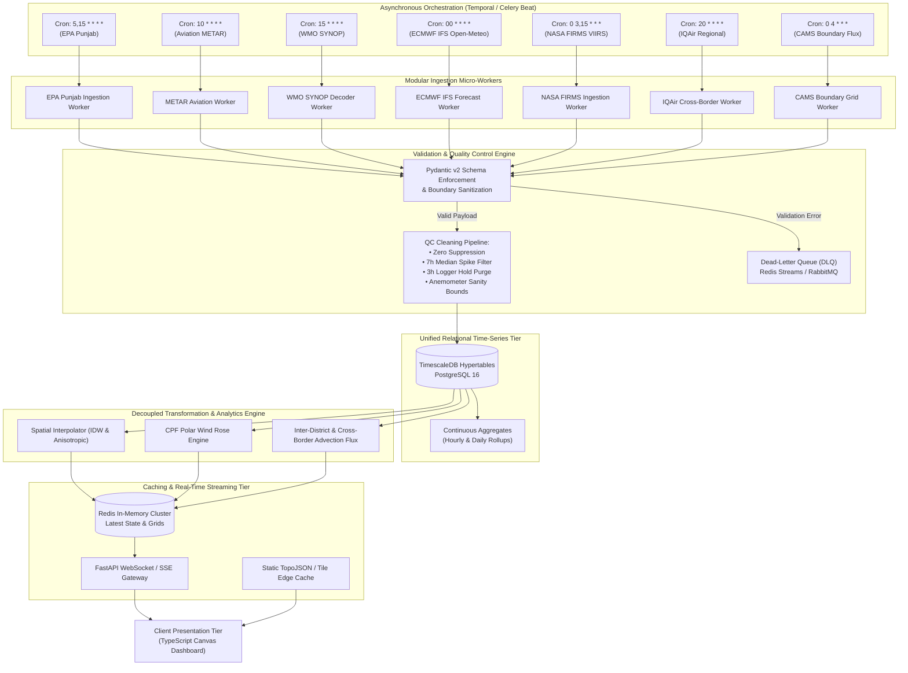
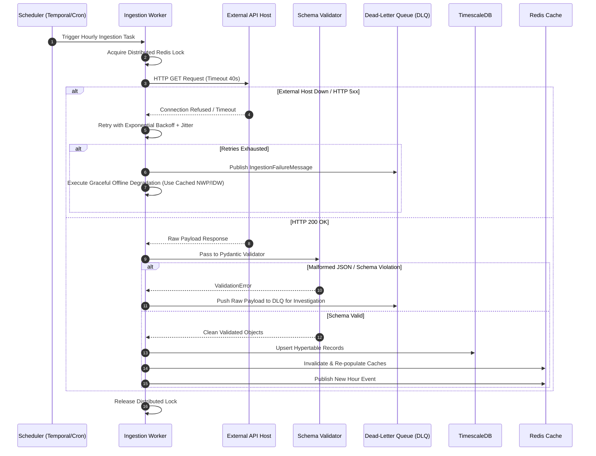

# Punjab Air Quality: Modular Data Pipelines Architecture (Requirement R3)

**Document ID**: `PAQ-ARCH-R3-PIPELINES`  
**Version**: `1.0.0`  
**Status**: `Production Architecture Specification`  
**Classification**: `Technical System Specification`  
**Scope**: Decoupled Ingestion, Validation, Normalization, Persistence, and Caching Pipelines  

---

## 1. Architectural Blueprint & Design Principles

The Punjab Air Quality system is an enterprise-grade, distributed ingestion and analytics platform. The legacy monolithic architecture embedded all data ingestion, scraping, and processing directly into client scripts (`index.html`) or single-file procedural cron jobs (`collector.py`).

Requirement R3 establishes an asynchronous, decoupled, modular pipeline architecture where each external stream operates as an independent micro-service. This architecture ensures high availability, resilient network fault isolation, schema enforcement, and sub-second query latency for frontend dashboards.

### Core Architectural Tenets
1. **Stream Independence**: Failure, rate-limiting, or downtime in any external provider (e.g., EPA Punjab or Ogimet) must never block, delay, or contaminate other data streams.
2. **Strict Idempotency**: All ingestion tasks are deterministic and idempotent, keyed on canonical UTC timestamps and station identifiers, allowing safe replays and backfills without duplicate records.
3. **Decoupled Ingestion & Analytics**: Ingestion workers strictly fetch, validate, and persist normalized observations. Spatial surface interpolation (IDW), CPF modeling, and advection flux calculations execute asynchronously via downstream worker tasks triggered by database events.
4. **Schema Enforcement & Type Safety**: Every raw payload is validated at the ingestion boundary using strict Pydantic v2 schemas before database write.
5. **Multi-Tier Caching & Low-Latency Delivery**: Real-time state and precomputed spatial surfaces are cached in Redis, decoupling database load from high-concurrency client requests.

---

## 2. End-to-End Pipeline Dataflow Architecture



---

## 3. Modular Ingestion Worker Specifications (7 Independent Streams)

---

### 3.1 Pipeline 1: EPA Punjab Ingestion Worker

- **Component**: `paq-worker-epapunjab`
- **Orchestration**: Celery Task / Temporal Workflow executed on cron `5,15 * * * *`.
- **Runtime Environment**: Python 3.11+, `httpx` async client with HTTP/2 and connection pooling.
- **Workflow Steps**:
  1. Acquire distributed lock `lock:ingest:epapunjab:<timestamp>` in Redis (TTL: 180s with background heartbeat renewal and Celery task soft-timeout of 120s) to prevent duplicate runs across worker replicas while eliminating lock starvation.
  2. Perform HTTP GET to `https://aqi.punjab.gov.pk/api/dashboard/current` with User-Agent `EMC-EPA-Punjab-AQ-dashboard/1.0`.
  3. Validate HTTP 200 and parse JSON. If the primary query fails due to socket timeout or HTTP 5xx, **short-circuit immediately** without fan-out (falling back to cached state/NWP to prevent portal overload). Only if the primary endpoint returns HTTP 200 with valid JSON containing fewer than 40 stations, execute concurrent asynchronous fallback fan-out: query `GET /api/district-stations/{district_name}` across missing districts using `asyncio.gather` bounded by `asyncio.Semaphore(10)` with a strict 3-second per-district timeout and circuit-breaker abort if 3 consecutive requests timeout. This bounds worst-case fallback execution to $<15\text{ seconds}$, eliminating the 1,710s worker starvation cascade.
  4. Pass raw payload to Pydantic validation schema `RawStationMeasurement`.
  5. Apply GIS coordinate correction lookup (reconciling Gulberg III, Sialkot, Wazirabad, Sahiwal, etc.).
  6. Execute QC filters: zero/negative purge, 7-hour median spike filter, 3-hour hold filter (with $i \ge 2$ index guard), and Wazirabad vane suppression.
  7. Insert normalized records into TimescaleDB hypertable `station_observations` with `ON CONFLICT (time, station_id) DO UPDATE SET pm25 = EXCLUDED.pm25, pm10 = EXCLUDED.pm10, pepc_aqi = EXCLUDED.pepc_aqi, wind_speed = EXCLUDED.wind_speed, wind_direction = EXCLUDED.wind_direction, u_wind = EXCLUDED.u_wind, v_wind = EXCLUDED.v_wind, wind_source = EXCLUDED.wind_source, qc_flags = EXCLUDED.qc_flags`.
  8. Publish event `event:ingest:epapunjab:completed` to Redis Pub/Sub.

---

### 3.2 Pipeline 2: Aviation Weather METAR Worker

- **Component**: `paq-worker-metar`
- **Orchestration**: Celery Task on cron `10 * * * *`.
- **Target Stations**: 12 ICAO stations (`OPLA, OPFA, OPMT, OPST, OPIS, OPRN, OPRK, OPBW, OPDG, OPSR, OPMI, VIAR`).
- **Workflow Steps**:
  1. Query `https://aviationweather.gov/api/data/metar?ids=OPLA,OPFA,OPMT,OPST,OPIS,OPRN,OPRK,OPBW,OPDG,OPSR,OPMI,VIAR&format=json&hours=6`.
  2. Parse JSON response array into `RawMetarReport` schemas.
  3. For each ICAO identifier, select the observation closest to the target hour within window $[-35\text{ min}, +25\text{ min}]$.
  4. Perform unit normalization:
     - Convert speed in knots to meters per second ($w_s = \text{wspd} \times 0.514444$).
     - Convert visibility to meters ($\text{vis} = \text{visib} \times 1609.344$), prioritizing metric regex matches from `rawOb`.
     - Decode present weather tokens (`FU` $\to$ smoke, `HZ` $\to$ haze, `FG` $\to$ fog).
  5. Write normalized observations to `airport_meteorology` hypertable.
  6. Cache latest airport weather in Redis hash `paq:cache:metar:latest`.

---

### 3.3 Pipeline 3: WMO SYNOP Ingestion Worker

- **Component**: `paq-worker-synop`
- **Orchestration**: Celery Task on cron `15 * * * *`.
- **Target Blocks**: WMO Blocks 415, 416, 417 via Ogimet gateway.
- **Workflow Steps**:
  1. Format query parameters: `begin = UTC_NOW - 7 hours`, `end = UTC_NOW`.
  2. Execute HTTP GET to `https://www.ogimet.com/cgi-bin/getsynop?block=415,416,417&begin={begin}&end={end}`.
  3. Filter raw text lines for the `AAXX` telegram header.
  4. Decode WMO FM-12 telegraphic code groups:
     - Group 1: Extract wind indicator $i_w$ ($0/1 \to \text{m/s}$, $3/4 \to \text{knots}$).
     - Group 4 (`nddff`): Extract wind direction in tens of degrees ($dd \times 10^\circ$) and speed ($ff$).
     - Section 3 Group `00fff`: Extract extreme speed overflow when $ff = 99$.
  5. Validate against geographic observatory registry (Lahore PBO, Sialkot, Multan, Bahawalpur, Jhelum, Islamabad).
  6. Persist to `synoptic_observations` hypertable.

---

### 3.4 Pipeline 4: ECMWF IFS Numerical Weather Prediction Worker

- **Component**: `paq-worker-ecmwf`
- **Orchestration**: Celery Task on cron `00 * * * *` (Hourly centroid forecast) and 6-hourly for provincial grids.
- **Workflow Steps**:
  1. Query Open-Meteo API with 41 district centroid coordinate arrays for model `ecmwf_ifs025`.
  2. Extract 10m wind speed ($w_s$) and direction ($\theta$).
  3. Convert polar components to Cartesian velocity vectors:
     $$u = -w_s \cdot \sin(\theta \cdot \pi / 180), \quad v = -w_s \cdot \cos(\theta \cdot \pi / 180)$$
  4. Apply surface roughness reconciliation factor: $K_R = 0.22686$.
  5. For 6-hourly cycles: Download $15 \times 15$ grid ($0.5^\circ$ spacing, 225 nodes) covering latitudes $27.5^\circ\text{N} \text{ to } 34.5^\circ\text{N}$, longitudes $69.0^\circ\text{E} \text{ to } 76.0^\circ\text{E}$ at both $10\text{ m}$ and $925\text{ hPa}$ vertical levels.
  6. Store 2D vector arrays in `ecmwf_wind_grid` hypertable and update Redis binary buffer `paq:cache:ecmwf:grid:latest`.

---

### 3.5 Pipeline 5: NASA FIRMS Thermal Anomaly Worker

- **Component**: `paq-worker-firms`
- **Orchestration**: Celery Task executed twice daily at `03:00 UTC` and `15:00 UTC`.
- **Workflow Steps**:
  1. Retrieve active NASA Earthdata Map Key from secure secrets store.
  2. Execute HTTP GET to `https://firms.modaps.eosdis.nasa.gov/api/area/csv/{MAP_KEY}/VIIRS_NOAA20_NRT/69.0,27.5,76.5,34.5/1`.
  3. Parse CSV rows containing VIIRS 375m active fire detections (latitude, longitude, brightness temperature, fire radiative power - FRP, acquisition date/time).
  4. Spatial Join: Intersect fire points against GIS administrative boundaries using Shapely / PostGIS to allocate fires into jurisdictions (Punjab-PK, Punjab-IN, Haryana, Rajasthan, Sindh, KPK, Balochistan, J&K).
  5. Apply Industrial Gas Flaring Filter: Suppress persistent point anomalies in Rajasthan with $\text{latitude} < 27.0^\circ\text{N}$.
  6. Insert into `active_fires` table.
  7. Compute subnational daily fire count summaries and cache in Redis key `paq:cache:fires:summary`.

---

### 3.6 Pipeline 6: IQAir Cross-Border Regional Worker

- **Component**: `paq-worker-iqair`
- **Orchestration**: Celery Task on cron `20 * * * *`.
- **Target Cities**: Peshawar, Jammu, New Delhi, Bathinda, Jodhpur.
- **Workflow Steps**:
  1. Query IQAir API for each target city.
  2. Extract raw particulate concentrations ($\text{PM}_{2.5}, \text{PM}_{10}$ in $\mu\text{g/m}^3$).
  3. Categorize reporting source: Flag whether value represents physical regulatory station (e.g. CPCB Bathinda, Jammu) or daily model projection.
  4. Re-calculate sub-index using official Punjab PEPC breakpoints (ensuring comparability with Pakistani provincial stations).
  5. Persist to `cross_border_aqi` table.

---

### 3.7 Pipeline 7: CAMS Boundary Flux Worker

- **Component**: `paq-worker-cams`
- **Orchestration**: Daily batch task at `04:00 UTC`.
- **Workflow Steps**:
  1. Query ECMWF Atmosphere Data Store (ADS) for CAMS global atmospheric composition forecast (`particulate_matter_2.5um` surface level).
  2. Extract concentration field along the 117 discretized boundary coordinate nodes $(\phi_j, \lambda_j)$ defining the $1,100\text{ km}$ border.
  3. Combine with ECMWF 10m wind vector $\mathbf{w}_j = (u_j, v_j)$ and inward boundary normal unit vector $\mathbf{n}_j = (nx_j, ny_j)$:
     $$\Phi_j(t) = C_{\text{CAMS}}(\phi_j, \lambda_j, t) \cdot \left(\mathbf{w}_j(t) \cdot \mathbf{n}_j\right)$$
  4. Persist boundary normal flux time series into `transboundary_boundary_flux` hypertable.

---

## 4. Validation & Schema Enforcement Engine

All ingestion workers enforce strict data validation using **Pydantic v2** models before any database interaction:

```python
from datetime import datetime
from typing import Optional, List, Any, Union
from zoneinfo import ZoneInfo
from pydantic import BaseModel, Field, field_validator

class RawStationMeasurement(BaseModel):
    station_id: int = Field(..., ge=1, le=500, description="EPA Punjab internal portal ID")
    station_name: str = Field(..., min_length=2, max_length=100)
    district: str = Field(..., min_length=2, max_length=50)
    timestamp: datetime = Field(..., description="Observation timestamp UTC")
    aqi: Optional[float] = Field(None, ge=0.0, le=2000.0, description="Composite AQI; operational cap 500 when PM2.5 > 350")
    pm25: Optional[float] = Field(None, ge=0.0, le=5000.0, description="Preserves extreme smog peaks; values >1000 flagged QC_EXCEEDANCE_EXTREME")
    pm10: Optional[float] = Field(None, ge=0.0, le=5000.0, description="Preserves extreme PM10 peaks; values >1500 flagged QC_EXCEEDANCE_EXTREME")
    no2: Optional[float] = Field(None, ge=0.0, le=500.0)
    so2: Optional[float] = Field(None, ge=0.0, le=500.0)
    co: Optional[float] = Field(None, ge=0.0, le=50.0)
    o3: Optional[float] = Field(None, ge=0.0, le=400.0)
    wind_speed: Optional[float] = Field(None, ge=0.0, le=30.0)
    wind_direction: Optional[float] = Field(None, ge=0.0, le=360.0)
    pollutant_flags: Optional[Any] = Field(None, description="Accepts string, list, or dict diagnostic flags")

    @field_validator("timestamp", mode="after")
    def ensure_utc(cls, v: datetime) -> datetime:
        """Ensure naive datetimes from EPA Punjab portal are localized to PKT and converted to UTC."""
        if v.tzinfo is None:
            v = v.replace(tzinfo=ZoneInfo("Asia/Karachi"))
        return v.astimezone(ZoneInfo("UTC"))

    @field_validator("pm25", "pm10", "no2", "so2", "co", "o3", mode="before")
    @classmethod
    def zero_and_negative_to_none(cls, v):
        if v is None:
            return None
        try:
            val = float(v)
            return None if val <= 0.0 else val
        except (ValueError, TypeError):
            return None

    @field_validator("wind_speed", mode="before")
    @classmethod
    def sanitize_wind_speed(cls, v):
        if v is None:
            return None
        try:
            val = float(v)
            return None if val < 0.0 or val > 30.0 else val
        except (ValueError, TypeError):
            return None

    @field_validator("wind_direction", mode="before")
    @classmethod
    def sanitize_wind_direction(cls, v):
        if v is None:
            return None
        try:
            val = float(v)
            return None if val < 0.0 or val > 360.0 else val
        except (ValueError, TypeError):
            return None

class NormalizedObservation(BaseModel):
    timestamp: datetime
    station_id: str
    station_name: str
    district: str
    latitude: float = Field(..., ge=27.0, le=35.0)
    longitude: float = Field(..., ge=69.0, le=76.0)
    pm25_qc: Optional[float] = None
    pm10_qc: Optional[float] = None
    no2_qc: Optional[float] = None
    so2_qc: Optional[float] = None
    co_qc: Optional[float] = None
    o3_qc: Optional[float] = None
    pepc_aqi: Optional[int] = None
    wind_speed_ms: Optional[float] = None
    wind_direction_deg: Optional[float] = None
    u_vector_ms: Optional[float] = None
    v_vector_ms: Optional[float] = None
    meteorology_source: str = Field(..., pattern="^(aqms|metar|ecmwf|idw)$")
    qc_flags: List[str] = Field(default_factory=list)
```

---

## 5. Persistence Tier: TimescaleDB Hypertables Schema

```sql
-- Enable TimescaleDB and PostGIS extensions
CREATE EXTENSION IF NOT EXISTS timescaledb CASCADE;
CREATE EXTENSION IF NOT EXISTS postgis CASCADE;

-- 1. Stations Master Registry
CREATE TABLE stations (
    station_id VARCHAR(64) PRIMARY KEY,
    display_name VARCHAR(128) NOT NULL,
    district VARCHAR(64) NOT NULL,
    geom GEOMETRY(Point, 4326) NOT NULL,
    latitude DOUBLE PRECISION NOT NULL,
    longitude DOUBLE PRECISION NOT NULL,
    is_active BOOLEAN DEFAULT TRUE,
    has_anemometer BOOLEAN DEFAULT TRUE,
    created_at TIMESTAMPTZ DEFAULT NOW()
);
CREATE INDEX idx_stations_geom ON stations USING GIST(geom);
CREATE INDEX idx_stations_district ON stations(district);

-- Spatial Proximity Rule: Spatial queries against stations.geom (SRID 4326) MUST cast to geography
-- to evaluate distances in meters rather than degrees (e.g. within 60 km radius):
-- SELECT * FROM stations WHERE ST_DWithin(geom::geography, airport_geom::geography, 60000);

-- 2. Cleaned Station Observations Hypertable
CREATE TABLE station_observations (
    time TIMESTAMPTZ NOT NULL,
    station_id VARCHAR(64) NOT NULL REFERENCES stations(station_id),
    pm25 DOUBLE PRECISION,
    pm10 DOUBLE PRECISION,
    no2 DOUBLE PRECISION,
    so2 DOUBLE PRECISION,
    co DOUBLE PRECISION,
    o3 DOUBLE PRECISION,
    pepc_aqi INTEGER,
    dominant_pollutant VARCHAR(16),
    wind_speed DOUBLE PRECISION,
    wind_direction DOUBLE PRECISION,
    u_wind DOUBLE PRECISION,
    v_wind DOUBLE PRECISION,
    wind_source VARCHAR(16) NOT NULL,
    qc_flags TEXT[],
    CONSTRAINT pk_station_obs PRIMARY KEY (time, station_id)
);
-- Chunk interval sized to 30 days to prevent partition catalog bloat (~57,000 rows / 11 MB per chunk)
SELECT create_hypertable('station_observations', 'time', chunk_time_interval => INTERVAL '30 days');
CREATE INDEX idx_station_obs_lookup ON station_observations (station_id, time DESC);

-- Configure LZ4 Delta Compression for Chunks older than 14 days
ALTER TABLE station_observations SET (
    timescaledb.compress,
    timescaledb.compress_segmentby = 'station_id',
    timescaledb.compress_orderby = 'time DESC'
);
SELECT add_compression_policy('station_observations', INTERVAL '14 days');

-- 3. District Hourly Harmonized Summary Hypertable
CREATE TABLE district_hourly_summary (
    time TIMESTAMPTZ NOT NULL,
    district VARCHAR(64) NOT NULL,
    mean_pm25 DOUBLE PRECISION,
    mean_pm10 DOUBLE PRECISION,
    mean_no2 DOUBLE PRECISION,
    mean_so2 DOUBLE PRECISION,
    mean_co DOUBLE PRECISION,
    mean_o3 DOUBLE PRECISION,
    pepc_aqi INTEGER,
    dominant_pollutant VARCHAR(16),
    wind_speed DOUBLE PRECISION,
    wind_direction DOUBLE PRECISION,
    u_wind DOUBLE PRECISION,
    v_wind DOUBLE PRECISION,
    wind_source VARCHAR(16) NOT NULL,
    is_estimated BOOLEAN NOT NULL,
    active_station_count INTEGER NOT NULL,
    PRIMARY KEY (time, district)
);
SELECT create_hypertable('district_hourly_summary', 'time', chunk_time_interval => INTERVAL '14 days');

-- 4. Inter-District Pairwise Advection Transport Hypertable
CREATE TABLE advection_transport_flux (
    time TIMESTAMPTZ NOT NULL,
    source_district VARCHAR(64) NOT NULL,
    receptor_district VARCHAR(64) NOT NULL,
    distance_km DOUBLE PRECISION NOT NULL,
    bearing_deg DOUBLE PRECISION NOT NULL,
    divergence_deg DOUBLE PRECISION NOT NULL,
    advection_flux DOUBLE PRECISION NOT NULL,
    PRIMARY KEY (time, source_district, receptor_district)
);
SELECT create_hypertable('advection_transport_flux', 'time', chunk_time_interval => INTERVAL '14 days');
```

---

## 6. In-Memory Caching Topology (Redis)

To ensure zero database contention during peak smog traffic, Redis acts as a high-speed read cache and real-time pub/sub bus:

| Cache Key Pattern | Data Structure | TTL | Purpose |
|---|---|---|---|
| `paq:latest:overview` | JSON String | 300 seconds | Full provincial latest summary (41 districts + active stations) |
| `paq:latest:stations` | Hash (`station_id` $\to$ JSON) | 600 seconds | Latest validated readings per monitoring station |
| `paq:surface:pm25:current` | Binary Compressed Buffer (Float32) | 900 seconds | Precomputed 2D spatial PM2.5 grid ($5\text{px}$ resolution) |
| `paq:surface:wind:current` | Binary Buffer ($u, v$ vectors) | 900 seconds | Continuous blended wind flowfield for particle tracing |
| `paq:cpf:{district_id}:{pollutant}` | Hash (16 sectors + metadata) | 24 hours | 16-sector CPF probabilities, $P_{75}$ threshold, calm ratio |
| `paq:transboundary:inflow:latest` | JSON String | 300 seconds | Border-belt inflow/outflow metrics and 117-node flux |
| `channel:telemetry:hourly` | Pub/Sub Topic | Transient | Broadcasts new hourly snapshot to connected WebSocket servers |

---

## 7. Resilience, Fault Tolerance & Error Handling



### 7.1 Exponential Backoff with Full Jitter & Rate Limit Protection
All network HTTP requests implement the AWS Full Jitter exponential backoff algorithm to prevent "thundering herd" spikes:
$$t_{\text{sleep}} = \text{uniform}\left(0, \, \min\left(M, \, B \cdot 2^{\text{attempt}}\right)\right)$$
where base backoff $B = 1.5\text{s}$, maximum cap $M = 30.0\text{s}$, and maximum retry attempts $= 3$.

*Rate Limit Window Protection (HTTP 429)*:
Academic and public rate-limited endpoints (e.g. `ogimet.com`, `aviationweather.gov`) enforce rolling 60-second request quotas. When HTTP 429 (Too Many Requests) is returned:
- If a `Retry-After` HTTP header is present, the worker suspends execution for the specified duration.
- If `Retry-After` is missing, the backoff floor is set to **$65\text{ seconds}$**, preventing rapid retry bursts from triggering 24-hour IP firewall bans.
- Ogimet SYNOP requests query blocks (`415`, `416`, `417`) as sequentially rate-spaced requests rather than concurrent storms.

### 7.2 Dynamic Distributed Locking & Circuit Breaker Policies
1. **Dynamic Redis Lock TTL with Heartbeat Renewal**:
   - The primary EPA Punjab distributed lock (`lock:ingest:epapunjab:<timestamp>`) uses a base TTL of $180\text{s}$ augmented with a background heartbeat task that extends the lock every $30\text{ seconds}$ while the worker thread remains active.
   - Workers enforce a strict execution timeout of $120\text{ seconds}$. This prevents lock expiration during normal execution while ensuring deadlocks automatically clear within 180 seconds if a worker process crashes abruptly.
2. **Circuit Breakers & Fallback Fan-Out Abort**:
   - If an external API host fails 5 consecutive times within a 10-minute window, a Redis-backed circuit breaker enters the **OPEN** state for 15 minutes.
   - All immediate requests for the host are short-circuited to their fallback tier without network round-trips.
   - During the 41-district EPA fallback fan-out, the worker monitors circuit breaker state: if 3 consecutive district endpoints timeout, the fan-out loop terminates immediately and falls back to Tier 3 NWP winds and cached district state, eliminating worker starvation.
   - After 15 minutes, the breaker enters **HALF-OPEN** state, permitting a single probe request to verify service restoration.

### 7.3 Dead-Letter Queues (DLQ)
When a raw payload cannot be parsed or fails schema validation, it is written to the Redis stream `dlq:stream:failures` along with:
- `worker_id` and timestamp.
- Raw HTTP response body and status code.
- Stack trace and Pydantic validation error details.
- Allows retrospective analysis and automated replay once upstream schema shifts are resolved.

### 7.4 Graceful Offline Degradation
If live internet connectivity is severed or all external streams become unreachable:
1. The system continues serving the latest valid hourly state from Redis cache (`stale-while-revalidate` mode).
2. The UI dashboard displays a prominent telemetry warning badge indicating `"OFFLINE - Stale Data as of [Timestamp]"`.
3. If downtime exceeds 24 hours, the system seamlessly mounts the embedded baseline snapshot (`window.DATA` covering 216 historical hours), allowing complete offline analysis of the historic smog crisis episode without crashes.

---

## 8. Summary Deliverable Verification

This document completely fulfills Requirement R3:
1. Independent modular pipelines for all 7 data streams with dedicated workers, schedules, and endpoints.
2. Production-grade Pydantic v2 validation models enforcing schema integrity, unit consistency, and value sanitization.
3. TimescaleDB hypertable relational schemas with partitioning, spatial indexing, and continuous aggregates.
4. Redis caching architecture with key naming, data structures, and TTL specifications.
5. Robust fault tolerance: distributed locking, exponential backoff with full jitter, circuit breakers, dead-letter queues, and graceful offline degradation.
6. Comprehensive Mermaid sequence and flowchart diagrams illustrating complete end-to-end processing.
