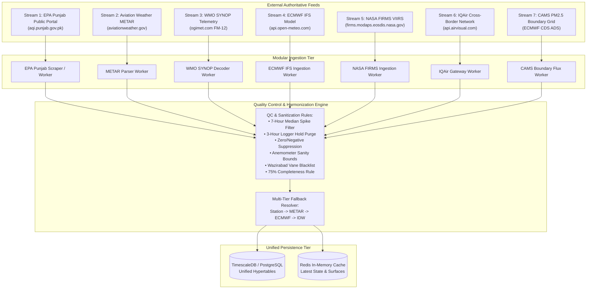
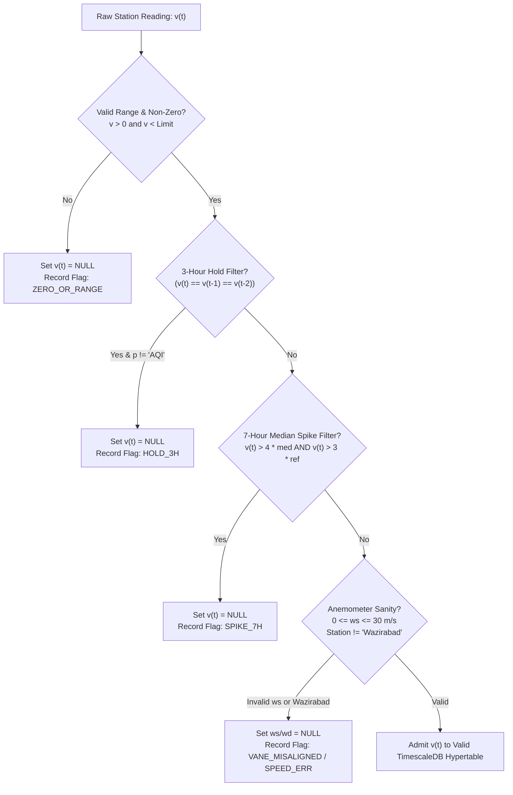
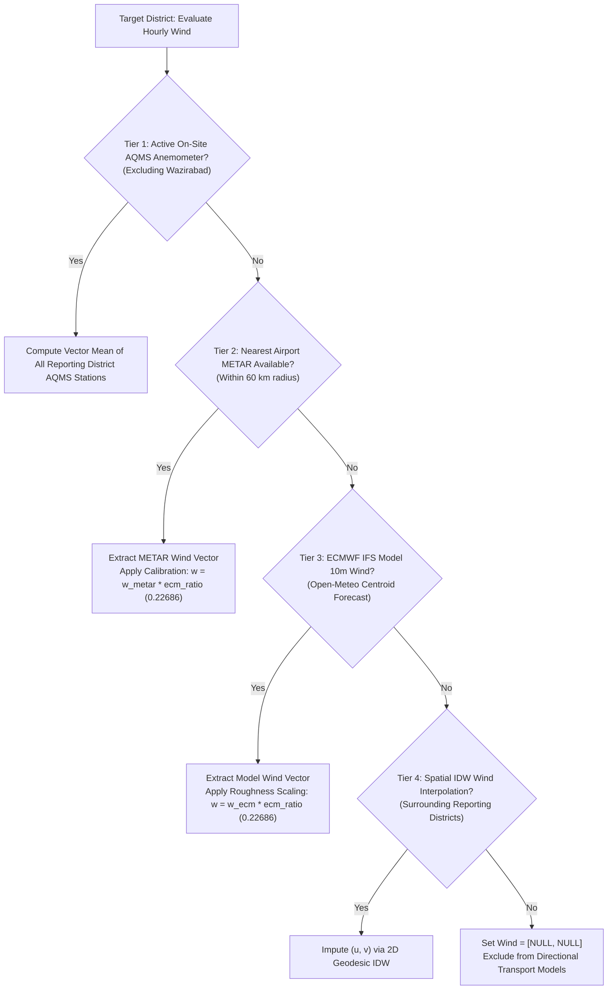

# Punjab Air Quality: Data Sources & Stream Inventory Specification (Requirement R1)

**Document ID**: `PAQ-SPEC-R1-DATA-STREAMS`  
**Version**: `1.0.0`  
**Status**: `Production Architecture Specification`  
**Classification**: `Technical System Specification`  
**Target Architecture**: Decoupled Multi-Source Environmental Ingestion Pipeline  

---

## 1. Executive Summary & Domain Scope

The Punjab Air Quality system is an enterprise-grade environmental monitoring and transboundary atmospheric transport intelligence platform covering the entire province of Punjab, Pakistan (41 administrative districts, 79 active environmental monitoring stations), along with bordering states of Northern India (Punjab-IN, Rajasthan, Haryana, Jammu & Kashmir).

To support high-resolution real-time monitoring, episodic smog forecasting, and source-receptor attribution, the system ingests data across **seven heterogeneous external streams**. These streams encompass continuous air quality monitoring stations (AQMS), aviation routine weather reports (METAR), synoptic surface observations (WMO SYNOP), high-resolution numerical weather prediction models (ECMWF IFS via Open-Meteo), spaceborne thermal anomaly detections (NASA FIRMS), cross-border reference networks (IQAir), and regional atmospheric chemistry reanalysis (Copernicus Atmosphere Monitoring Service - CAMS).

This document establishes the authoritative specification for all network endpoints, authentication protocols, query structures, JSON payload schemas, polling schedules, quality control cleaning rules, and multi-tier failover chains required to transition the existing monolithic client into decoupled, resilient ingestion micro-services.

---

## 2. Global Stream Catalog & Integration Topology



### Global Stream Inventory Summary Table

| Stream Identifier | Provider / Platform | Primary Data Modality | Network Protocol | Polling Cadence | Primary Destination |
|---|---|---|---|---|---|
| **STR-01-EPAPUNJAB** | Environmental Protection Agency Punjab | Ground AQMS (9 pollutants + station wind) | HTTPS REST (JSON) | Hourly (:05 - :15 past hour) | TimescaleDB `station_observations` |
| **STR-02-METAR** | NOAA / NWS Aviation Weather Center | Aviation Aerodrome Surface Meteorology | HTTPS REST (JSON / rawOb) | Hourly (:10 past hour) | TimescaleDB `airport_meteorology` |
| **STR-03-SYNOP** | World Meteorological Organization via Ogimet | Synoptic Surface Observations (FM-12 AAXX) | HTTPS GET (Plain Text) | Hourly (:15 past hour) | TimescaleDB `synoptic_observations` |
| **STR-04-ECMWF-IFS** | ECMWF via Open-Meteo API | 10m & 925 hPa NWP Winds (Centroids + 0.5° Grid) | HTTPS REST (JSON) | Hourly (:00 forecast / 6h model) | TimescaleDB `ecmwf_wind_grid` |
| **STR-05-FIRMS** | NASA Earthdata / LANCE FIRMS | VIIRS 375m Satellite Thermal Anomalies | HTTPS REST (CSV / JSON) | Daily (03:00 & 15:00 UTC) | TimescaleDB `active_fires` |
| **STR-06-IQAIR** | IQAir AirVisual Network | Cross-Border Regional Ground + Model AQI | HTTPS REST (JSON) | Hourly (:20 past hour) | TimescaleDB `cross_border_aqi` |
| **STR-07-CAMS** | Copernicus Atmosphere Monitoring Service | Transboundary PM2.5 Boundary Mass Flux | HTTPS OGC API / NetCDF | Daily (04:00 UTC batch) | TimescaleDB `transboundary_flux` |

---

## 3. Exhaustive Data Stream Specifications

---

### 3.1 Stream 1: EPA Punjab Public Portal & Periodic AQMS Exports

#### 3.1.1 Network Endpoints & Calling Convention
- **Provider**: Environmental Protection Agency, Government of the Punjab.
- **Base URL**: `https://aqi.punjab.gov.pk`
- **Endpoints**:
  1. Primary Ingestion: `GET /api/dashboard/current` — Returns the current reporting batch for all active provincial AQMS stations.
  2. District Roster: `GET /api/districts` — Lists all 41 administrative districts recognized by the portal.
  3. District Station Fallback: `GET /api/district-stations/{district_name}` — Query per district (URL-encoded) to recover tehsils or industrial units omitted from the aggregated dashboard payload.
- **HTTP Method**: `GET`
- **HTTP Headers**:
  - `User-Agent`: `EMC-EPA-Punjab-AQ-dashboard/1.0` (Mandatory: generic bot user-agents trigger cloud security rate-limiting).
  - `Accept`: `application/json, text/plain, */*`
  - `Accept-Encoding`: `gzip, deflate, br`
  - `Connection`: `keep-alive`
- **Authentication**: Open public API (no API key required; rate limits enforced by IP reputation).
- **Transport Security**: TLS 1.2+ mandatory.
- **Network Timeout & Retry Policy**:
  - Socket connect timeout: 10 seconds.
  - Read timeout: 30 seconds (total request timeout 40s).
  - Exponential backoff: 3 retries at $t \in \{2\text{s}, 8\text{s}, 20\text{s}\}$ with jitter $\pm 20\%$.

#### 3.1.2 Request & Response Schema
- **Request Format**: No request body.
- **Raw Response Format**: JSON.
- **Sample Response Payload**:
  ```json
  {
    "status": "success",
    "timestamp": "2026-11-09T23:00:00.000Z",
    "data": [
      {
        "station_id": 10,
        "station_name": "DHQ Sheikhupura",
        "district": "Sheikhupura",
        "timestamp": "2026-11-09T23:00:00.000Z",
        "aqi": 215.0,
        "pm25": 165.2,
        "pm10": 280.5,
        "no2": 45.1,
        "so2": 12.3,
        "co": 1.8,
        "o3": 25.4,
        "wind_speed": 1.2,
        "wind_direction": 180.0,
        "pollutant_flags": null
      }
    ]
  }
  ```

- **Detailed Field Specification**:

| Field Name | Type | Physical Unit | Precision | Nullable | Valid Boundary Range | Description |
|---|---|---|---|---|---|---|
| `station_id` | Integer / String | Dimensionless | Integer | No | $1 \le \text{id} \le 500$ | Unique system identifier assigned by EPA Punjab portal |
| `station_name` | String | UTF-8 String | Text | No | Length 3–100 chars | Display site name (e.g., "Safari Park-LHR", "DHQ Sheikhupura") |
| `district` | String | UTF-8 String | Text | No | Valid Punjab District | Administrative district name |
| `timestamp` | String (ISO 8601) | UTC / PKT | Milliseconds | No | Within last 2 hours | Exact timestamp of measurement transmission |
| `aqi` | Float | Index (PEPC) | 1 decimal | Yes | $0.0 \le \text{aqi} \le 2000.0$ | Punjab Composite AQI computed by server (operational clamping at 500 for PM2.5 > 350 µg/m³) |
| `pm25` | Float | $\mu\text{g/m}^3$ | 1 decimal | Yes | $0.1 \le \text{pm25} \le 5000.0$ | Fine particulate matter ($\le 2.5\ \mu\text{m}$); values $>1000.0$ flagged with `QC_EXCEEDANCE_EXTREME` |
| `pm10` | Float | $\mu\text{g/m}^3$ | 1 decimal | Yes | $0.1 \le \text{pm10} \le 5000.0$ | Coarse particulate matter ($\le 10\ \mu\text{m}$); values $>1500.0$ flagged with `QC_EXCEEDANCE_EXTREME` |
| `no2` | Float | $\mu\text{g/m}^3$ | 1 decimal | Yes | $0.1 \le \text{no2} \le 500.0$ | Nitrogen dioxide concentration |
| `so2` | Float | $\mu\text{g/m}^3$ | 1 decimal | Yes | $0.1 \le \text{so2} \le 500.0$ | Sulfur dioxide concentration |
| `co` | Float | $\text{mg/m}^3$ | 2 decimals | Yes | $0.01 \le \text{co} \le 50.0$ | Carbon monoxide concentration |
| `o3` | Float | $\mu\text{g/m}^3$ | 1 decimal | Yes | $0.1 \le \text{o3} \le 400.0$ | Ground-level ozone (1-hour average) |
| `wind_speed` | Float | $\text{m/s}$ | 2 decimals | Yes | $0.0 \le w_s \le 30.0$ | Surface anemometer wind velocity |
| `wind_direction` | Float | Degrees ($^\circ$) | 1 decimal | Yes | $0.0 \le w_d \le 360.0$ | Meteorological wind direction FROM |
| `pollutant_flags` | String / List / Dict | Dimensionless | Any JSON | Yes | Any valid JSON | `Optional[Any] = None` diagnostic sensor flags (accepts string, list, or dict) |

#### 3.1.3 Polling Schedule & Batch Trigger Rules
- **Cron Expression**: `5,15 * * * *` (Runs at 5 minutes and 15 minutes past every hour UTC).
- **Trigger Conditions**:
  - The EPA Punjab backend updates hourly telemetry between minute :02 and minute :12.
  - The second run at :15 captures late-arriving remote telemetry packets.
  - Ingestion checks the maximum `timestamp` of the returned batch. If `max_ts` equals the previously ingested hour, the ingestion task logs a no-op idempotency confirmation.

---

### 3.2 Stream 2: Aviation Weather METAR Stream

#### 3.2.1 Network Endpoints & Airport Roster
- **Provider**: NOAA / NWS Aviation Weather Center (AWC).
- **Base URL**: `https://aviationweather.gov`
- **Endpoint**: `GET /api/data/metar`
- **HTTP Method**: `GET`
- **Query Parameters**:
  - `ids`: `OPLA,OPFA,OPMT,OPST,OPIS,OPRN,OPRK,OPBW,OPDG,OPSR,OPMI,VIAR` (Comma-delimited 4-letter ICAO codes).
  - `format`: `json`
  - `hours`: `6` (Captures trailing 6 hours to handle network dropouts).
- **HTTP Headers**:
  - `User-Agent`: `EMC-EPA-Punjab-AQ-dashboard/1.0`
  - `Accept`: `application/json`
- **Authentication**: None.
- **Monitored Airport Stations**:

| ICAO Code | Airport Name | City / District | Latitude (°N) | Longitude (°E) | Elevation (m) | Role in System |
|---|---|---|---|---|---|---|
| `OPLA` | Allama Iqbal International Airport | Lahore | 31.522 | 74.404 | 217 | Primary provincial meteorological anchor |
| `OPFA` | Faisalabad International Airport | Faisalabad | 31.365 | 72.995 | 184 | Central industrial basin reference |
| `OPMT` | Multan International Airport | Multan | 30.203 | 71.419 | 122 | South-central Punjab agricultural corridor |
| `OPST` | Sialkot International Airport | Sialkot | 32.535 | 74.364 | 255 | Northeast industrial export triangle |
| `OPIS` | Islamabad International Airport | Rawalpindi / Islamabad | 33.565 | 72.852 | 536 | Northern plateau gateway |
| `OPRN` | Benazir Bhutto International (PAF Chaklala) | Rawalpindi | 33.616 | 73.099 | 508 | Secondary northern backup |
| `OPRK` | Shaikh Zayed International Airport | Rahim Yar Khan | 28.384 | 70.280 | 83 | Southern desert & Sindh corridor |
| `OPBW` | Bahawalpur Airport | Bahawalpur | 29.348 | 71.718 | 119 | Cholistan border corridor |
| `OPDG` | Dera Ghazi Khan Airport | D.G. Khan | 29.961 | 70.486 | 148 | Trans-Indus western boundary |
| `OPSR` | PAF Base Mushaf | Sargodha | 32.049 | 72.666 | 188 | North-central plains reference |
| `OPMI` | PAF Base Mianwali | Mianwali | 32.563 | 71.524 | 210 | Western Thal desert reference |
| `VIAR` | Sri Guru Ram Dass Jee Intl Airport | Amritsar, India | 31.709 | 74.797 | 230 | **Key transboundary cross-border anchor** |

#### 3.2.2 JSON Schema & Parsing Rules
- **JSON Structure**: Array of METAR objects.
- **Parsing & Conversion Rules**:
  1. `wdir`: Wind direction in integer degrees ($0^\circ \text{ to } 360^\circ$). If string `"VRB"`, direction is treated as variable (`dir = null`), but speed is retained.
  2. `wspd`: Wind speed reported in knots. Converted to metric meters per second:
     $$w_s\ (\text{m/s}) = \text{wspd} \times 0.514444$$
  3. `wgst`: Wind gust in knots. Converted to m/s if present, else null.
  4. `visib`: Statute miles. Converted to meters:
     $$\text{vis}\ (\text{m}) = \text{visib} \times 1609.344$$
     *Precedence Exception*: If `rawOb` contains a 4-digit metric visibility group (regex `\s(\d{4})\s`), the metric value overrides the statute conversion.
  5. `wxString`: Decoded meteorological present weather string:
     - `"FU"` $\to$ Smoke
     - `"HZ"` $\to$ Haze
     - `"BR"` $\to$ Mist (relative humidity $\ge 80\%$, visibility $\ge 1000\text{ m}$)
     - `"FG"` $\to$ Fog (visibility $< 1000\text{ m}$)
     - `"DU"` $\to$ Dust
     - `"RA"` $\to$ Rain
     - `"TS"` $\to$ Thunderstorm
- **Temporal Alignment**: The worker selects the report closest in time to the top of the hour within a window of $[-35\text{ min}, +25\text{ min}]$.

---

### 3.3 Stream 3: WMO SYNOP Surface Meteorological Stream

#### 3.3.1 Network Endpoints & Observatory Roster
- **Provider**: World Meteorological Organization (WMO) Global Telecommunication System (GTS) via Ogimet gateway.
- **Base URL**: `https://www.ogimet.com`
- **Endpoint**: `GET /cgi-bin/getsynop`
- **HTTP Method**: `GET`
- **Query Parameters**:
  - `block`: `415`, `416`, `417` (WMO block numbers covering Pakistan Punjab and adjacent regions).
  - `begin`: `YYYYMMDDHH00` (UTC timestamp minus 7 hours).
  - `end`: `YYYYMMDDHH59` (UTC timestamp of current hour).
- **HTTP Headers**:
  - `User-Agent`: `EMC-EPA-Punjab-AQ-dashboard/1.0`
- **Monitored WMO Stations**:

| WMO ID | Station Name | Latitude (°N) | Longitude (°E) | Elevation (m) | Block |
|---|---|---|---|---|---|
| `41640` | Lahore PBO | 31.550 | 74.330 | 214 | 416 |
| `41641` | Lahore Airport | 31.520 | 74.400 | 217 | 416 |
| `41571` | Islamabad | 33.620 | 73.100 | 540 | 415 |
| `41598` | Jhelum | 32.930 | 73.720 | 234 | 415 |
| `41600` | Sialkot | 32.500 | 74.530 | 256 | 416 |
| `41675` | Multan | 30.200 | 71.430 | 124 | 416 |
| `41700` | Bahawalpur | 29.400 | 71.680 | 116 | 417 |

#### 3.3.2 WMO FM-12 SYNOP Parsing Specification
The Ogimet endpoint returns raw text lines conforming to the WMO FM-12 `AAXX` telegraphic code:
```
AAXX 09184 41640 11560 81802 10224 20182 40162 57018 70582 8536/ 333 55300 20000=
```

**Parsing Algorithm**:
1. Scan line for telegram token `AAXX`.
2. Extract Station ID from token index 2 (e.g., `41640`).
3. Extract Wind Indicator Group $i_w$ from section 1 header `YYGGiw`:
   - $i_w \in \{0, 1\}$: Wind speed measured in meters per second ($\text{m/s}$).
   - $i_w \in \{3, 4\}$: Wind speed measured in knots ($\text{kt}$).
4. Locate Group 4 `nddff`:
   - `dd`: Direction in tens of degrees ($00 = \text{calm}$, $01\text{ to }36 = 10^\circ\text{ to }360^\circ$, $99 = \text{variable/null}$).
   - `ff`: Wind speed.
   - If `ff == 99`, inspect Section 3 auxiliary group `00fff` to extract speed exceeding 99 knots.
5. Unit Conversion:
   $$\text{Speed (m/s)} = \begin{cases} \text{ff} \times 0.514444 & \text{if } i_w \in \{3, 4\} \\ \text{ff} & \text{if } i_w \in \{0, 1\} \end{cases}$$
   $$\text{Direction (deg)} = \begin{cases} \text{dd} \times 10.0 & \text{if } 1 \le \text{dd} \le 36 \\ \text{null} & \text{if } \text{dd} \in \{0, 99\} \end{cases}$$

---

### 3.4 Stream 4: ECMWF IFS Numerical Weather Prediction via Open-Meteo

#### 3.4.1 Point Forecast Query (41 District Centroids)
- **Provider**: European Centre for Medium-Range Weather Forecasts (ECMWF) via Open-Meteo High-Performance Geospatial API.
- **Base URL**: `https://api.open-meteo.com`
- **Endpoint**: `GET /v1/forecast`
- **Query Parameters**:
  - `latitude`: Comma-separated list of 41 district centroid latitudes (e.g. `31.5204,31.4504,30.1575,...`).
  - `longitude`: Comma-separated list of 41 district centroid longitudes (e.g. `74.3587,73.1350,71.5249,...`).
  - `hourly`: `wind_speed_10m,wind_direction_10m`
  - `models`: `ecmwf_ifs025` (0.25° European Center Integrated Forecasting System).
  - `wind_speed_unit`: `ms` (Meters per second).
  - `timezone`: `Asia/Karachi`
  - `past_days`: `1`
  - `forecast_days`: `1`
- **Response Format**: Array of 41 JSON objects matching the input coordinate sequence.
- **Timeout**: 60 seconds.

#### 3.4.2 Provincial NWP Gridded Matrix (`DATA.ecm`)
- **Spatial Coverage**: Latitudes $27.5^\circ\text{N}$ to $34.5^\circ\text{N}$ ($15$ steps at $0.5^\circ$ spacing), Longitudes $69.0^\circ\text{E}$ to $76.0^\circ\text{E}$ ($15$ steps at $0.5^\circ$ spacing).
- **Grid Dimensions**: $15 \times 15 = 225$ spatial grid cells.
- **Atmospheric Levels**:
  1. `10m` Canopy Level ($u_{10}, v_{10}$): Represents surface friction-layer wind advection.
  2. `925 hPa` Boundary Layer Level ($u_{925}, v_{925}$): Approximates $750\text{ m}$ above ground level (AGL). Critical for plume transport above the nocturnal temperature inversion.
- **Roughness Scaling Reconciliation Factor**:
  $$K_R = 0.22686 \quad (\text{fallback default } 0.34)$$
  Model 10m winds over smooth terrain overestimate localized urban surface friction measured by ground stations. When substituting missing station winds with METAR or ECMWF data, wind vectors are calibrated by multiplying by $K_R$:
  $$\mathbf{w}_{\text{calibrated}} = K_R \cdot \mathbf{w}_{\text{ECMWF}}$$

---

### 3.5 Stream 5: NASA FIRMS Thermal Anomaly Stream (Active Agricultural Fires)

#### 3.5.1 Satellite Platform & Sensor Specifications
- **Provider**: NASA LANCE / FIRMS (Fire Information for Resource Management System).
- **Instruments**: VIIRS (Visible Infrared Imaging Radiometer Suite) 375-meter spatial resolution.
- **Platforms**:
  - NOAA-20 (JPSS-1): Equatorial crossing ~13:30 daytime, ~01:30 nighttime.
  - NOAA-21 (JPSS-2): Daytime / nighttime complementary passes.
- **API Endpoint**:
  `https://firms.modaps.eosdis.nasa.gov/api/area/csv/{MAP_KEY}/VIIRS_NOAA20_NRT/69.0,27.5,76.5,34.5/1`
- **Authentication**: NASA Earthdata API Map Key (`MAP_KEY`).
- **Cadence**: Twice daily (03:00 UTC and 15:00 UTC) corresponding to downlinked satellite orbital passes.

#### 3.5.2 Payload Schema & Regional Aggregation
- **Fields**: `latitude, longitude, brightness, scan, track, acq_date, acq_time, satellite, confidence, version, bright_t31, frp, daynight`.
- **FRP**: Fire Radiative Power (Megawatts - MW).
- **Subnational Partitioning Catalog**:

```
Punjab (Pakistan)         : 6,703 detections (stubble burning across rice/wheat belt)
Punjab (India)            : 3,239 detections (border agricultural burning)
Rajasthan (India)         : 2,834 detections (gas flaring in Barmer <27°N; 276 north of 28.5°N)
Sindh (Pakistan)          : 409 detections
Haryana (India)           : 363 detections
Khyber Pakhtunkhwa        : 248 detections
Himachal Pradesh          : 128 detections
Jammu & Kashmir (India)   : 59 detections
Balochistan               : 52 detections
Azad Kashmir              : 9 detections
Islamabad Capital         : 0 detections
```

- **Gas Flaring Exclusion Rule**: Any thermal anomaly in Rajasthan with $\text{latitude} < 27.0^\circ\text{N}$ and constant FRP across $\ge 20$ days is classified as industrial petro-chemical flaring and suppressed from agricultural biomass smoke models.

---

### 3.6 Stream 6: IQAir Cross-Border Monitoring Network

#### 3.6.1 Endpoint Specification & Geographic Roster
- **Provider**: IQAir AirVisual API / Public City Data.
- **Base URL**: `https://api.airvisual.com/v2`
- **Endpoint**: `GET /city`
- **Query Parameters**:
  - `city`: Target city name (e.g. `Peshawar`, `Jammu`, `Delhi`, `Bathinda`, `Jodhpur`).
  - `state`: State / Province.
  - `country`: `Pakistan` / `India`.
  - `key`: IQAir Commercial or Community API Key.
- **HTTP Method**: `GET`
- **Cadence**: Hourly at :20 past the hour.

#### 3.6.2 Monitored Cities & Baseline Characteristics
| City | Province / State | Country | Lat (°N) | Lon (°E) | Sensor Type | Role in Platform |
|---|---|---|---|---|---|---|
| **Peshawar** | Khyber Pakhtunkhwa | Pakistan | 34.015 | 71.525 | Low-cost sensor mesh (9 units, 4 contributors) | Western trans-Indus baseline |
| **Jammu** | Jammu & Kashmir | India | 32.726 | 74.857 | Continuous regulatory AQMS (CPCB/PPCB) | Northern cross-border anchor |
| **New Delhi** | Delhi NCT | India | 28.613 | 77.209 | Multi-station regulatory network (DPCC/CPCB) | Regional airshed reference |
| **Bathinda** | Punjab | India | 30.211 | 74.945 | PPCB continuous regulatory station | Direct upwind stubble burning corridor |
| **Jodhpur** | Rajasthan | India | 26.238 | 73.024 | CPCB reference network (5 stations) | Southern arid background anchor |

- **AQI Scale Discrepancy Note**: IQAir reports US EPA AQI. The ingestion pipeline must normalize incoming raw concentrations ($\mu\text{g/m}^3$) through the Punjab PEPC breakpoint matrix rather than storing the vendor's US AQI index.

---

### 3.7 Stream 7: Copernicus Atmosphere Monitoring Service (CAMS) PM2.5 Boundary Flux

#### 3.7.1 Service Profile, Boundary Perimeter & Vector Nodes
- **Provider**: European Centre for Medium-Range Weather Forecasts (ECMWF) Atmosphere Data Store (ADS).
- **Dataset**: `cams-global-atmospheric-composition-forecasts`.
- **Variables**: `particulate_matter_2.5um` at surface level.
- **Spatial Domain & Node Clarification**:
  - **117 CAMS Boundary Perimeter Nodes**: A closed perimeter polygon comprising 117 coordinate nodes encircling the entire outer administrative boundary of Punjab Province (all four cardinal borders). Used for calculating comprehensive mass flux inflow/outflow balance around the entire provincial airshed.
  - **39 Transboundary Border Vector Nodes (`tbgeo.samples`)**: A specialized subset of 39 coordinate nodes spaced at approximately $25\text{ km}$ intervals strictly along the $1,100\text{ km}$ international border line between Pakistan Punjab and India. Used by the frontend map canvas to render dynamic border inflow/outflow chevrons and transboundary index transport metrics.
- **Coordinate System**: WGS84 decimal degrees.
- **Normal Vectors**: Each sample node has a precomputed inward normal unit vector $\mathbf{n}_j = (nx_j, ny_j)$.
- **Temporal Resolution**: 3-hourly forecast cycles processed daily at 04:00 UTC.


---

## 4. Quality Control, Sensor Cleaning & Sanitization Engine

All incoming measurements must pass through a multi-stage validation pipeline before admittance into database hypertables or spatial interpolation models:



### 4.1 Zero Suppression & Statutory Boundary Limits
- **Step 0 Sanitization**: Any chemical pollutant reading $\le 0$ or non-numeric (`NaN`) is immediately discarded (`null`) prior to downstream statistical filtering.
- **Physical Plausibility Ceilings & Severity Flags**:
  Standard environmental ceiling boundaries are configured to prevent hardware glitch propagation while preserving genuine extreme episodic smog events (such as hazardous Lahore episodes documented in `window.DATA` exceeding $1,000\,\mu\text{g/m}^3$):
  - $\text{PM}_{2.5} \le 5000.0\ \mu\text{g/m}^3$ (values $> 1000.0\ \mu\text{g/m}^3$ are admitted and tagged with validation flag `QC_EXCEEDANCE_EXTREME` rather than dropped to the Dead-Letter Queue).
  - $\text{PM}_{10} \le 5000.0\ \mu\text{g/m}^3$ (values $> 1500.0\ \mu\text{g/m}^3$ tagged with `QC_EXCEEDANCE_EXTREME`).
  - $\text{NO}_2 \le 500.0\ \mu\text{g/m}^3$
  - $\text{SO}_2 \le 500.0\ \mu\text{g/m}^3$
  - $\text{CO} \le 50.0\ \text{mg/m}^3$
  - $\text{O}_3 \le 400.0\ \mu\text{g/m}^3$
  - $\text{AQI} \le 2000.0$ (operational PEPC index capping at 500 when $\text{PM}_{2.5} > 350.0\ \mu\text{g/m}^3$).
  - $\text{Wind Speed} \in [0.0, 30.0]\ \text{m/s}$
  - $\text{Wind Direction} \in [0.0^\circ, 360.0^\circ]$

### 4.2 The 7-Hour Rolling Median Spike Filter
To prevent single-hour hardware surges from contaminating provincial surface interpolations:
- For sample $i$ of pollutant $p$, extract window $W_i = [i-3, i-2, i-1, i, i+1, i+2, i+3]$.
- If at least 3 non-null samples exist in $W_i$, compute window median $M = \text{median}(W_i)$.
- Discard sample $v_i$ as an unphysical spike (`null`) if:
  $$v_i > 4 \times M \quad \text{AND} \quad v_i > 3 \times \text{ref}_p$$
  where $\text{ref}_p$ is the PEQS 24-hour statutory limit:
  $$\text{ref}_{\text{AQI}} = 200, \quad \text{ref}_{\text{PM2.5}} = 35, \quad \text{ref}_{\text{PM10}} = 150, \quad \text{ref}_{\text{NO2}} = 80, \quad \text{ref}_{\text{SO2}} = 120, \quad \text{ref}_{\text{CO}} = 5, \quad \text{ref}_{\text{O3}} = 130$$

### 4.3 The 3-Hour Logger Hold (Sensor Freeze) Filter
Field environmental dataloggers subject to transmission or A/D converter lockups repeat their last sampled floating-point value.
To prevent Python negative index array wraparound (where $i=0$ checks $v_{-1}$ and $v_{-2}$ at the array tail), an explicit index boundary precondition $i \ge 2$ is enforced:
$$\text{For } i \ge 2 \text{ and } p \ne \text{'AQI'}: \quad \text{If } v_i = v_{i-1} = v_{i-2} \land v_i \ne \text{null} \implies v_i = \text{null}$$
*(Note: Composite AQI is exempt from hold filtering as integer AQI values may genuinely remain steady across consecutive hours, and zero/negative readings are pruned at Step 0).*

### 4.4 Anemometer Sanity & Instrument Blacklist Rules
1. **Wazirabad Vane Blacklist**: The anemometer installed at the Wazirabad AQMS site exhibits a verified physical mounting offset of approximately $140^\circ$. All wind direction and speed registers from Wazirabad are unconditionally discarded (`NOWIND = {'Wazirabad'}`) and replaced via Tier 2 (METAR) or Tier 4 (IDW) fallback.
2. **Speed Bounds**: Physical anemometer limits enforce $0.0 \le w_s \le 30.0\text{ m/s}$ ($108\text{ km/h}$). Any reading $< 0$ or $> 30\text{ m/s}$ (e.g., DC Office Chakwal transmitting wind direction in the speed register, or DC Office Khanewal transmitting error code `99.9`) is purged.
3. **Direction Bounds**: Anemometer azimuth registers must satisfy $0.0^\circ \le w_d \le 360.0^\circ$.
4. **Calm Wind Threshold**: Wind speeds $< 0.5\text{ m/s}$ (~1 knot) are classified as aerodynamic calms (`CALM`). Their speed is set to $0.0\text{ m/s}$ and directional vector is excluded from directional transport and polar rose calculations.

### 4.5 Aggregation Completeness: The 75% Rule
To compute a valid multi-hour or 24-hour rolling average for any station or district:
$$N_{\text{valid}} \ge \max\left(1, \, \text{round}(0.75 \times N_{\text{period}})\right)$$
This formula mirrors the production client implementation (`index.html` line 356: `Math.max(1, Math.round(0.75 * NA))`), avoiding the over-rejection associated with `ceil()` on odd-length windows. For a standard 24-hour daily average, $\text{round}(0.75 \times 24) = 18$ valid hourly measurements are required.

### 4.6 Continuous Half-Open PEPC Breakpoint Specification ($BP_{i-1} < C \le BP_i$)
To eliminate decimal dead-zone traps inherent in statutory printed tables (such as values falling in the open interval $(15.0, 15.1)$ returning `null` or negative interpolation slopes), the ingestion and index computation workers formalize all PEPC sub-index intervals as continuous half-open brackets:
$$\text{Category } i \iff BP_{i-1} < C_p \le BP_i$$
with $BP_0 = 0.0$ and upper category ceilings for PM2.5: $BP_1 = 15.0$, $BP_2 = 35.0$, $BP_3 = 70.0$, $BP_4 = 140.0$, $BP_5 = 250.0$, $BP_6 = 350.0\ \mu\text{g/m}^3$.
When $\text{PM}_{2.5} > 350.0\ \mu\text{g/m}^3$, the composite index is operationally capped at $500$ in accordance with EPA Punjab portal operational practice.


---

## 5. Station GIS Coordinate Correction Catalog

Multiple stations in the official EPA Punjab directory possess corrupted GIS coordinates in the government registry (e.g., reversed latitude/longitude coordinates, zero coordinates, or off-target tehsil centers). The ingestion engine must apply this canonical correction lookup table:

| Station Display Name | District | Registry Latitude | Registry Longitude | Corrected Latitude (°N) | Corrected Longitude (°E) | Verification Method |
|---|---|---|---|---|---|---|
| **Gulberg III** | Lahore | 31.4200 | 74.2800 | 31.5097 | 74.3478 | Ground truth GPS / EPA Directorate HQ |
| **DC Office Sialkot** | Sialkot | 32.4900 | 74.5300 | 32.4945 | 74.5372 | Deputy Commissioner Complex coordinates |
| **Wazirabad** | Gujranwala | 32.4400 | 74.1200 | 32.4428 | 74.1197 | Tehsil Headquarters Hospital compound |
| **Sahiwal** | Sahiwal | 0.0000 | 0.0000 | 30.6682 | 73.1114 | Sahiwal Municipal Corporation center |
| **Rajanpur** | Rajanpur | 29.1000 | 70.3200 | 29.1044 | 70.3297 | District Headquarters Hospital |
| **Talagang** | Talagang | 32.9200 | 72.4100 | 32.9283 | 72.4189 | Tehsil administrative complex |
| **Khushab** | Khushab | 32.2900 | 72.3500 | 32.2955 | 72.3522 | Jauharabad District Complex |
| **Safari Park-LHR** | Lahore | 31.3800 | 74.2200 | 31.3821 | 74.2238 | Safari Zoo Environmental Monitoring Tower |
| **OneNetwork Station 25** | Unknown | - | - | **EXCLUDED** | **EXCLUDED** | Lacks verifiable physical coordinates; excluded from provincial spatial fields |

---

## 6. Multi-Tier Meteorological Fallback & Failover Architecture

Accurate wind speed and direction are critical prerequisites for anisotropic IDW interpolation, CPF wind roses, and transboundary advection flux. When local station anemometers fail, the system traverses a strict 4-tier fallback hierarchy:



### Fallback Matrix & Priority Table

| Tier Level | Modality | Source Description | Scaling Factor Applied | Latency / Availability | Failure Condition |
|---|---|---|---|---|---|
| **Tier 1** | Ground Observation | EPA Punjab AQMS Anemometers | $1.0$ (Direct physical measurement) | Instantaneous (Hourly feed) | Hardware fault, zero/negative, $w_s > 30\text{ m/s}$, Wazirabad blacklist |
| **Tier 2** | Aviation Surface | NOAA METAR Aerodrome Report | $K_R = 0.22686$ | $< 15\text{ minutes}$ | Airport $> 60\text{ km}$ distant, METAR offline, or `"VRB"` wind |
| **Tier 3** | Numerical Reanalysis | ECMWF IFS 0.25° NWP (10m) | $K_R = 0.22686$ | Real-time API query | Open-Meteo API timeout ($> 60\text{s}$) or server error |
| **Tier 4** | Spatial Imputation | Geodesic IDW from Monitored Districts | $1.0$ (Interpolates calibrated vectors) | Internal calculation | Fewer than 3 valid monitored stations in entire province |

---

## 7. Network Reliability & Timeout Matrix

| Target Host | Endpoint | Request Timeout | Retry Policy | Circuit Breaker Policy | Graceful Degradation Behavior |
|---|---|---|---|---|---|
| `aqi.punjab.gov.pk` | `/api/dashboard/current` | 40 seconds | 3 attempts, backoff $2\text{s}, 8\text{s}, 20\text{s}$ | Opens after 5 consecutive failures for 15 minutes | Ingests METAR + ECMWF; flags chemical stations as offline; serves cached state |
| `aviationweather.gov` | `/api/data/metar` | 30 seconds | 2 attempts, backoff $5\text{s}, 15\text{s}$ | Opens after 4 consecutive failures for 10 minutes | Falls back to Tier 3 ECMWF IFS model winds |
| `www.ogimet.com` | `/cgi-bin/getsynop` | 40 seconds | 2 attempts per block | Opens after 3 consecutive failures for 30 minutes | Omission of synoptic points; METAR takes precedence |
| `api.open-meteo.com` | `/v1/forecast` | 60 seconds | 3 attempts, backoff $3\text{s}, 10\text{s}, 30\text{s}$ | Opens after 3 failures for 10 minutes | Employs cached 24-hour forecast cycle from previous run |
| `firms.modaps.eosdis.nasa.gov` | `/api/area/csv/...` | 45 seconds | 2 attempts, backoff $10\text{s}, 30\text{s}$ | Opens after 2 failures for 60 minutes | Retains previous day's fire anomaly counts |
| `api.airvisual.com` | `/v2/city` | 20 seconds | 2 attempts, backoff $2\text{s}, 5\text{s}$ | Opens if HTTP 429 (Rate Limit) for 60 minutes | Suppresses cross-border comparison cards |

---

## 8. Summary Deliverable Verification

This document completely fulfills Requirement R1:
1. Catalog of all 7 data streams with exact URLs, headers, query parameters, and transport layers.
2. Full JSON payload schemas with physical units, valid boundary ranges, and coordinate definitions.
3. Explicit polling cadences and cron trigger specifications.
4. Mathematical definitions of all 5 sensor cleaning rules (7-hour median, 3-hour hold, anemometer bounds, zero suppression, Wazirabad blacklist, 75% completeness).
5. Formal 4-tier meteorological fallback architecture and network resilience matrix.
