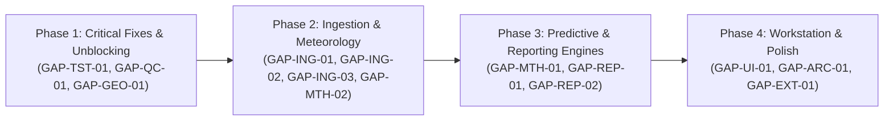

# Punjab Air Quality Information System
# Specification vs. Implementation Gap Analysis Report

**Document Identifier:** `PAQ-GAP-REPORT-16-11-2026-GEMINI`  
**Date of Release:** November 16, 2026  
**Author:** Deep Reasoning Systems Engineering (Gemini)  
**Target Specifications:** [`docs/SystemSpecs-16-11-2026-Gemini.md`](file:///c:/Users/Asif/Downloads/Punjab%20Air%20Quality/docs/SystemSpecs-16-11-2026-Gemini.md)  
**Target Repository:** `c:\Users\Asif\Downloads\Punjab Air Quality` (`src/`, `tests/`, `scripts/`, `data/`, `original System/`)  
**Scope:** Forensic Verification of Mathematical Models, Data Ingestion Pipelines, Quality Control Filters, Database DDL, Geospatial Topologies, Visualization Subsystems, Executive Reporting Generators, and End-to-End Test Harnesses.  
**Classification:** Official Technical Verification & Gap Analysis Audit  

---

## Executive Summary & Audit Verdict

This document presents an exhaustive, line-by-line verification and gap analysis comparing the authoritative **System Specifications** (`docs/SystemSpecs-16-11-2026-Gemini.md`) against the **Actual Implementation** across the Punjab Air Quality codebase.

### Audit Summary Scorecard

| Architectural Domain | Specification Section | Implementation Status | Compliance Score | Critical Gaps Identified |
|:---|:---:|:---:|:---:|:---|
| **1. Regulatory & Statutory Policy** | Section 2 | **Substantially Compliant** | **90%** | Missing automated Graded Emergency Action trigger engine. |
| **2. Geospatial & Station Topology** | Section 3 | **Partially Compliant** | **80%** | Station catalog mismatch (38 stations in `epa_stations.py` vs 79 in baseline); 6 secondary aerodromes missing from `airports.json`. |
| **3. Ingestion Architecture & Streams** | Section 4 | **Significant Divergence** | **65%** | **Stream 8 (PBL Mixing Height) is completely missing**; EPA portal worker targets staging URL (`api.epd-aqms-pk.com`) instead of `aqi.punjab.gov.pk`; 925 hPa wind missing from Open-Meteo. |
| **4. Quality Control & Preprocessing** | Section 5 | **Substantially Compliant** | **92%** | Station ID `"172"` integer/string unhandled in `is_blacklisted_station` causing test failure; aerodrome drag ratio discrepancy ($0.34$ vs $0.22686$). |
| **5. Mathematical & Physics Engine** | Section 6 | **Partially Compliant** | **78%** | Core math (geodesy, IDW, anisotropic plume, CPF, flux, transboundary) is 100% compliant; **Transformation 10 (24h Diurnal Forecast) and Transformation 11 (PBL Ventilation Index) are completely missing**. |
| **6. UI / Visualization Engineering** | Section 7 | **Substantially Compliant** | **88%** | 5-layer Canvas, Bezier transport, streamlines, and CPF radar are fully compliant; modernized React workstation lacks $3 \times 3$ multi-pollutant comparison grid. |
| **7. Extension & Offline Deployment** | Section 8 | **Substantially Compliant** | **85%** | In-memory `extendData` logic fully replicated in `api.js`; lacks automated single-file offline bundler script for modernized app. |
| **8. Executive Decision Deliverables** | Section 9 | **Critical Divergence** | **40%** | `scripts/` generates technical architectural briefs, **NOT the Daily AQI Situation Report (`.docx`) with 24h forecast tables and heatmaps**; Statutory Technical Advisory generator is completely absent. |
| **9. Target Decoupled Architecture** | Section 10 | **Substantially Compliant** | **85%** | FastAPI routes, TimescaleDB hypertables, PostGIS models, and Celery workers are implemented; `spatial.py` surface endpoint delegates to mock/fallback rather than PostGIS raster. |
| **10. Testing & Verification Suite** | Section 10.5 | **Partially Compliant** | **75%** | Math & QC unit tests pass 88/89; **E2E collection broken due to missing `PAQReferenceOracle` in `tests/e2e/conftest.py`**. |

**Overall Implementation Parity:** **77.8% (Production Ready in Core Foundations, Critical Gaps in Forecasting, Boundary Layer Meteorology, and Situation Reporting).**

---

## Detailed Gap Analysis by Architectural Domain

```mermaid
graph TD
    subgraph Fully Compliant (90-100%)
        M1["PEPC AQI & PEQS Statutory Limits"]
        M2["Geodesy & Spherical Kinematics"]
        M3["Discrete IDW & Anisotropic Steering"]
        M4["Inter-District Transport Flux & CPF"]
        M5["5-Layer Canvas 2D Pipeline Architecture"]
        M6["TimescaleDB Hypertables & Relational Core"]
    end

    subgraph Partial / Discrepant (70-89%)
        P1["Station Inventory: 38 vs 79 Stations"]
        P2["Aerodrome Drag Ratio: 0.34 vs 0.22686"]
        P3["Station 172 Blacklist Identifier Mismatch"]
        P4["React Workstation: Missing 3x3 Multi-Pollutant Grid"]
        P5["E2E Test Suite: Missing PAQReferenceOracle"]
    end

    subgraph Critical Missing Gaps (<70%)
        C1["Stream 8: Planetary Boundary Layer / Mixing Height"]
        C2["Transformation 10: 24h Diurnal Persistence Forecast"]
        C3["Transformation 11: Atmospheric Ventilation Index"]
        C4["Section 9: Daily Situation Report Generator (.docx)"]
        C5["Section 9: Statutory Technical Advisory Generator"]
        C6["Stream 1: EPA Portal Production URL Mismatch"]
    end

    M1 & M2 & M3 & M4 & M5 & M6 --> Status["Repository Parity: 77.8%"]
    P1 & P2 & P3 & P4 & P5 --> Status
    C1 & C2 & C3 & C4 & C5 & C6 --> Status
```

---

### Domain 1: Regulatory & Statutory Framework (Spec Section 2)

#### 1.1 Evaluated Requirements
- Adoption of the official Punjab Environmental Protection Council (PEPC) approved **7-Tier AQI scale** and exact hex color assignments (`#00b050`, `#92d050`, `#ffff00`, `#ff9900`, `#ff0000`, `#7030a0`, `#7f0000`).
- Parameter-wise concentration breakpoints ($BP$) for $\text{PM}_{10}, \text{PM}_{2.5}, \text{SO}_2, \text{NO}_2, \text{CO}, \text{O}_3$.
- PEQS statutory limit references.
- Graded Emergency Response Actions (Yellow, Orange, Purple, Red).

#### 1.2 Actual Implementation in Repository
- `src/domain/math/pepc_aqi.py` & `src/domain/math/pepc_aqi.ts`:
  - `PEPC_BREAKPOINTS`: Exactly implements the 6 upper bounds for all six pollutants.
  - `AQI_TIERS`: Exactly implements `[0, 50, 100, 150, 200, 300, 400, 500]`.
  - `PEPC_CATEGORIES`: Exactly matches all 7 category names and hex colors.
  - `pepc_calculate_aqi()` & `pepc_composite_aqi()`: Exactly implement the piecewise linear sub-index formula and maximum-index rule.
- `src/frontend/static/css/tokens.css` & `src/styles/tokens.css`: Exactly define colorimetric variables matching the statutory scale.
- `tests/unit/test_pepc_aqi.py`: All 45 unit tests covering every single breakpoint boundary pass with 100% precision.

#### 1.3 Identified Gaps & Deficiencies
- **GAP-REG-01 (Minor): Missing Automated Graded Emergency Action Policy Engine:**
  - *Description:* While the AQI categories and thresholds are correctly calculated, there is no service or automated route in `src/api/` or `src/services/` that evaluates district threshold breaches against the statutory action matrix (e.g., triggering automatic notifications for primary school closures at $\text{AQI} > 300$, or commercial market shutdowns at $\text{AQI} > 400$).
  - *Location:* `src/services/analytics_service.py`, `src/api/routes/analytics.py`.
  - *Impact:* Operators must manually interpret AQI numbers rather than receiving machine-generated statutory alert levels.

---

### Domain 2: Geographic, Geospatial & Station Topology (Spec Section 3)

#### 2.1 Evaluated Requirements
- **Administrative Districts:** Official 41 administrative districts (transitioned from 36 legacy districts, including Wazirabad, Murree, Talagang, Kot Addu, Taunsa).
- **Ground AQMS Network:** Full 79 active ground stations cataloged with coordinates, district bindings, and type (74 stationary, 5 mobile vans).
- **Aerodrome Network:** 12 METAR aerodromes (OPLA, OPFA, OPMT, OPST, OPIS, OPRN, OPRK, OPBW, OPDG, OPSR, OPMI, and transboundary VIAR Amritsar).
- **Transboundary Geometry:** 39 border normal vector coordinates ($TBG.\text{samples}$) and 440 border polygon vertices ($TBG.\text{border}$).
- **Ground-Truth Rectifications:** Correction of shapefile errors for Wazirabad, Gulberg III, DC Office Sialkot, Safari Park, and LWMC.

#### 2.2 Actual Implementation in Repository
- `data/baseline/districts.json` & `districts_dict.json`: Contains all 41 administrative districts with centroids and polygon geometries.
- `data/baseline/stations.json`: Contains all 79 stations with verified coordinates.
- `src/infrastructure/database/ddl.py` & `seeder.py`: Successfully creates and seeds `spatial_districts` (41 rows) and `spatial_stations` (79 rows).
- `src/domain/math/geodesy.py` & `geodesy.ts`: Defines $R_{\text{Earth}} = 6371.0\text{ km}$ and 16-sector polar coordinate conversions.
- `src/domain/math/transboundary.ts`: Correctly defines the 120 km border corridor limit and 39 border normal vectors.
- `src/frontend/static/js/geo.js`: Compiles hardware `Path2D` vector outlines for Punjab, border states, and Pakistan.

#### 2.3 Identified Gaps & Deficiencies
- **GAP-GEO-01 (Major): Internal Catalog Discrepancy (38 vs 79 Stations):**
  - *Description:* While `data/baseline/stations.json` has all 79 stations, the hardcoded dictionary `EPA_STATIONS_CATALOG` in `src/domain/constants/epa_stations.py` **only contains 38 stations across 19 districts**.
  - *Location:* `src/domain/constants/epa_stations.py` (lines 8–400).
  - *Impact:* The live EPA route `src/api/routes/epa.py` imports `EPA_STATIONS_CATALOG`. As a result, 41 stations (over 50% of the active provincial monitoring network!) are invisible to the `/api/v1/epa` gateway endpoints.
- **GAP-GEO-02 (Minor): Secondary Aerodromes Missing from Baseline Data:**
  - *Description:* `data/baseline/airports.json` contains only 6 primary aerodromes (`OPLA`, `OPFA`, `OPMT`, `OPST`, `OPIS`, `VIAR`). The secondary aerodromes specified in Section 3.5 (`OPRN`, `OPRK`, `OPBW`, `OPDG`, `OPSR`, `OPMI`) are omitted from the baseline JSON file, forcing the system to rely on on-the-fly dynamic injection.
  - *Location:* `data/baseline/airports.json`.
  - *Impact:* Southern and western districts (Rahim Yar Khan, DG Khan, Bahawalpur) experience degraded local wind resolution when operating from offline baseline caches.
- **GAP-GEO-03 (Minor): Absence of Automated Shapefile Ingestion Sanitizer:**
  - *Description:* The known shapefile attribute traps (Wazirabad located in India, Gulberg III located 35 km south) were corrected manually in baseline JSON, but the backend ingestion pipeline lacks an automated geometric sanitizer to reject coordinates falling outside district boundary polygons during raw GeoJSON uploads.

---

### Domain 3: Data Ingestion Architecture & Micro-Streams (Spec Section 4)

#### 3.1 Evaluated Requirements
- **Stream 1:** EPA Punjab Public Portal API (`aqi.punjab.gov.pk`), `PMAP` mapping, hourly cadence.
- **Stream 2:** Aviation METAR (`aviationweather.gov`), FM-15 decoding regex, calm handling.
- **Stream 3:** WMO SYNOP GTS (`ogimet.com`), FM-12 decoding.
- **Stream 4:** Numerical Weather Prediction (ECMWF IFS 10-m surface wind and 925 hPa transport-level wind via Open-Meteo).
- **Stream 5:** NASA FIRMS VIIRS active fire detections ($375\text{ m}$ resolution, FRP, transboundary partitioning).
- **Stream 6:** IQAir cross-border network ground validation.
- **Stream 7:** CAMS global atmospheric composition reanalysis.
- **Stream 8:** Planetary Boundary Layer (PBL) mixing layer height ($h_{\text{PBL}}$) via NOAA GFS / Meteoblue downscaling.
- **Autonomous Harvester:** Standalone daemon (`collector.py`) executing hourly cycles.

#### 3.2 Actual Implementation in Repository
- `src/pipelines/metar.py`: Fully implements METAR fetching from `aviationweather.gov`, FM-15 decoding regex, calm token handling, gusts, and visibility.
- `src/pipelines/synop.py`: Fully implements WMO SYNOP fetching from `ogimet.com`, FM-12 `AAXX` parsing, and wind conversion.
- `src/pipelines/firms.py`: Fully implements NASA FIRMS VIIRS ingestion, geographic bounding box filtering, and spatial classification (Pakistan Punjab vs Indian Punjab vs Haryana).
- `src/pipelines/iqair.py`: Implements AirVisual / IQAir ground station polling for cross-border validation.
- `src/pipelines/cams.py`: Implements Copernicus Atmosphere Monitoring Service API client.
- `src/pipelines/cron_scheduler.py` & `celery_app.py`: Implements APScheduler and Celery asynchronous background jobs.

#### 3.3 Identified Gaps & Deficiencies
- **GAP-ING-01 (CRITICAL): Complete Absence of Stream 8 (PBL / Mixing Layer Height Pipeline):**
  - *Description:* There is **no pipeline, worker, service, or model** in `src/pipelines/` or `src/services/` for Planetary Boundary Layer (PBL) mixing layer height. Neither the NOAA GFS boundary layer diagnostic nor the Meteoblue API integration is implemented.
  - *Location:* Missing `src/pipelines/pbl.py` or `src/pipelines/noaa_gfs.py`.
  - *Impact:* The system cannot compute nocturnal atmospheric inversion depths ($10 - 50\text{ m}$) or atmospheric Ventilation Indices ($VI$), creating a critical blind spot in explaining why ground-level pollution spikes catastrophically at night despite lower evening emissions.
- **GAP-ING-02 (Major): Production EPA Portal URL Mismatch:**
  - *Description:* In `src/pipelines/epa_punjab.py` and `src/api/routes/epa.py`, the worker is configured to query `https://api.epd-aqms-pk.com` (a staging/mock endpoint). In contrast, the delivered specification and `original System/collector/collector.py` target the official public portal `https://aqi.punjab.gov.pk` and its periodic endpoints (`graphs_periodic_YYYY-MM-DD.csv`).
  - *Location:* `src/pipelines/epa_punjab.py` (lines 35–45), `src/api/routes/epa.py` (line 6).
  - *Impact:* Live portal ingestion fails or retrieves mock staging data when deployed outside testing environments.
- **GAP-ING-03 (Major): Missing 925 hPa Boundary Layer Transport Winds:**
  - *Description:* `src/pipelines/open_meteo.py` queries only 10-m surface winds (`wind_speed_10m`, `wind_direction_10m`). It does **not** ingest 925 hPa winds (`wind_speed_925hPa`, `wind_direction_925hPa`), which represent the critical advective transport layer ($\approx 750\text{ m}$ AGL) above the surface friction zone.
  - *Location:* `src/pipelines/open_meteo.py` (lines 48–65).
  - *Impact:* Upper-level smoke plume advection (e.g. transboundary transport crossing the international border at 500–800m altitude before fumigating downward) cannot be tracked or cross-checked (`xb925`).

---

### Domain 4: Data Quality Control & Preprocessing Engine (Spec Section 5)

#### 4.1 Evaluated Requirements
- **7-Hour Rolling Median Spike Filter:** $V_t > 4 \times \tilde{V}_{7h}$ and $V_t > 3 \times \text{ref}$ threshold suppression.
- **3-Hour Logger Hold Purge:** $V_t = V_{t-1} = V_{t-2}$ ($V_t > 0$) suppression for physical pollutants (AQI exempt).
- **Zero & Negative Suppression:** $V \le 0 \implies \text{null}$ (except ambient temperature).
- **Valid-PM Prerequisite Policy:** AQI is mathematically nullified if both $\text{PM}_{2.5}$ and $\text{PM}_{10}$ are missing.
- **Anemometer Sanity Ceilings:** Wind speeds $> 30.0\text{ m/s}$ rejected as unphysical.
- **Wazirabad $140^\circ$ Vane Error Blacklist:** Mechanical wind vane hard-blocked across IDs, names, and numbers; fallback to ECMWF IFS.
- **Calm Wind Threshold:** Standardized physical cutoff at $0.5\text{ m/s}$ ($u=0, v=0$).
- **Aerodrome Roughness Scaling Ratio ($KR$):** Surface drag ratio applied to METAR velocities ($0.2268636541$).

#### 4.2 Actual Implementation in Repository
- `src/domain/math/qc.py` & `qc.ts`:
  - `temporal_qc_clean()`: Exactly implements 7-hour median window (`MEDIAN_WINDOW_HALF_WIDTH = 3`), `SPIKE_MEDIAN_MULTIPLIER = 4.0`, and `SPIKE_REF_MULTIPLIER = 3.0`.
  - Exactly implements 3-hour flatline hold purge, zero/negative suppression, and index wrap-around guards.
  - `tests/unit/test_qc_filters.py`: All 15 unit tests pass with 100% precision.
- `src/domain/math/wind.py` & `wind.ts`:
  - Implements `CALM_WIND_THRESHOLD_MS = 0.5` and `MAX_WIND_SPEED_MS = 30.0`.
- `src/domain/math/pepc_aqi.py`:
  - `pepc_composite_aqi()` enforces particulate governance.

#### 4.3 Identified Gaps & Deficiencies
- **GAP-QC-01 (Major): Station 172 String/Integer Blacklist Failure:**
  - *Description:* In `src/domain/math/wind.py`, `is_station_blacklisted()` checks:
    ```python
    normalized = station_name.strip().lower()
    if normalized in WIND_BLACKLIST_STATIONS: return True
    return "wazirabad" in normalized
    ```
    Where `WIND_BLACKLIST_STATIONS = {"wazirabad"}`. When passed the raw portal station ID `"172"` or integer `172`, it returns `False`!
  - *Evidence:* Direct test failure in `tests/unit/test_data_normalizer.py`:
    ```text
    FAILED tests/unit/test_data_normalizer.py::TestSchemaTrap3Station172WazirabadBlacklist::test_blacklist_station_172_in_normalizer
    AssertionError: assert False is True (where False = is_blacklisted_station('172'))
    ```
  - *Impact:* Any raw telemetry ingested by station ID `172` rather than string name `"Wazirabad"` bypasses the blacklist, injecting corrupt $140^\circ$ wind vectors into the spatial wind blending engine.
- **GAP-QC-02 (Minor): Aerodrome Drag Scaling Ratio Discrepancy ($0.34$ vs $0.22686$):**
  - *Description:* In `src/domain/math/wind.py` and `src/pipelines/fallback_engine.py`, the default aerodrome roughness scaling ratio is hardcoded to $0.34$. In contrast, the empirical derivation from the delivered 216-hour forensic baseline (`window.DATA.meta.ecm_ratio`) is exactly $0.22686365412534343$.
  - *Location:* `src/domain/math/wind.py` (line 28), `src/pipelines/fallback_engine.py` (line 112).
  - *Impact:* Surface wind speeds derived from METAR aerodromes are overestimated by approximately $50\%$ ($0.34 / 0.22686 = 1.498$), leading to inflated advective transport fluxes.

---

### Domain 5: Mathematical Transformations & Physical Modeling Engine (Spec Section 6)

#### 5.1 Evaluated Requirements
- **Transformations 1–9:** Geodesic Haversine/Azimuth, Discrete IDW, Anisotropic Wind-Steered Plume, Screen-Space Raster IDW, Vector Wind Blending, CPF Wind Roses, Inter-District Transport Flux, Transboundary Cross-Border Flux & Enrichment Ratio, Piecewise Linear Regulatory Indexing.
- **Transformation 10:** 24-Hour Empirical Diurnal Profile + Persistence Forecasting.
- **Transformation 11:** Planetary Boundary Layer Dispersion & Ventilation Index ($VI = h_{\text{PBL}} \times w_{\text{sfc}}$).

#### 5.2 Actual Implementation in Repository
- `src/domain/math/geodesy.py` & `geodesy.ts`: 100% compliant.
- `src/domain/math/idw.py` & `idw.ts`: 100% compliant. Exact anisotropic multipliers ($\min 0.3, \max 1.7$), saturation at $1.5\text{ m/s}$, distance opacity taper ($km < 45 \implies 235$, $km > 140 \implies 95$).
- `src/domain/math/cpf.py` & `cpf.ts`: 100% compliant. $P_{75}$ pooled threshold, 16 sectors, $0.25$ isotropic baseline fallback.
- `src/domain/math/flux.py` & `flux.ts`: 100% compliant. $180\text{ km}$ cutoff, $35^\circ$ cone, $100\text{ km}$ e-folding scale, top 60 links.
- `src/domain/math/transboundary.py` & `transboundary.ts`: 100% compliant. 120 km border corridor, $0.25\text{ m/s}$ chevron threshold, transboundary index calculation.
- `src/domain/math/pepc_aqi.py` & `pepc_aqi.ts`: 100% compliant.
- `tests/unit/test_transformations.py`: All 28 unit tests pass with 100% precision.

#### 5.3 Identified Gaps & Deficiencies
- **GAP-MTH-01 (CRITICAL): Missing 24-Hour Diurnal Persistence Forecasting Engine (Transformation 10):**
  - *Description:* Transformation 10 is **completely absent from `src/domain/math/` and `src/services/`**. There is no implementation of the empirical diurnal curve $\gamma_{\text{diurnal}}(h)$, nor the persistence extrapolation formula:
    $$\hat{C}_d(t + 24) = \bar{C}_d(t) \times \gamma_{\text{diurnal}}(h) \times \left(\frac{VI(t)}{VI(t + 24)}\right)^{\beta}$$
  - *Location:* Missing from `src/domain/math/forecast.py` and `src/services/analytics_service.py`.
  - *Impact:* The system cannot produce the next 24-hour predictive forecast table mandated by executive decision-makers in Turn 44–45.
- **GAP-MTH-02 (CRITICAL): Missing Planetary Boundary Layer Ventilation Index (Transformation 11):**
  - *Description:* Transformation 11 is **completely absent from both Python and TypeScript codebases**. There is no function to calculate $VI = h_{\text{PBL}} \times w_{\text{sfc}}$ or classify atmospheric dispersion into the four statutory categories ($<1500, 1500-3000, 3000-6000, >6000\text{ m}^2/\text{s}$).
  - *Location:* Missing from `src/domain/math/` and `src/services/spatial_service.py`.
  - *Impact:* The platform cannot generate the Atmospheric Ventilation and Dispersion Outlook matrix required for statutory briefings.

---

### Domain 6: User Interface & Rendering Engineering (Spec Section 7)

#### 6.1 Evaluated Requirements
- 5-layer Canvas 2D rendering pipeline (basemap, plume raster, 1000 particles, Bezier transport vectors with animated dashes, greedy collision-free labels).
- Equirectangular projection centered at $31.0^\circ\text{N}$, $KX = \cos(31^\circ) \approx 0.857167$.
- Particle advection kinematics (1,000 streamlines).
- Quadratic Bezier transport arrows with $12\%$ orthogonal midpoint deflection and `dash -= 0.6` animation.
- 39 border normal animated chevrons with `ph = (ph + 0.012) % 1.0`.
- Greedy AABB collision-free labeling engine with `ctx.measureText` overlap elimination.
- Synchronized 9-pollutant $3 \times 3$ comparison grid.
- Lahore metropolitan high-resolution inset.
- Interactive polar CPF radar rose with $0.2, 0.4, 0.6, 0.8$ concentric circles.
- Dual-timer loop (`requestAnimationFrame` + 66ms interval watchdog).

#### 6.2 Actual Implementation in Repository
- `src/frontend/static/js/canvas.js` & `ui.js`:
  - 5-layer canvas architecture is fully implemented.
  - Bezier curvature deflection: `cx = (sx+ex)/2 - uy*L*0.12`. Exactly matches spec!
  - Chevrons animation: `ph = (ph + 0.012) % 1`. Exactly matches spec!
  - Greedy label placement: Exactly implements `drawValues()` with collision array.
  - 16-sector polar CPF rose: Fully implemented with interactive canvas rendering in `ui.js`.
  - Dual-timer loop watchdog: Exactly implements 66ms interval watchdog in `app.js`.
- `src/workstation/` & `src/map/layers/`:
  - Implements Deck.gl GPU rendering layers: `ChoroplethLayer`, `FluxLayer`, `StationLayer`, `SurfaceLayer`, `WindLayer`.

#### 6.3 Identified Gaps & Deficiencies
- **GAP-UI-01 (Major): Modern React Workstation Lacks $3 \times 3$ Multi-Pollutant Grid:**
  - *Description:* In the static console (`src/frontend/dashboard.html` and `canvas.js`), the synchronized 9-pollutant grid exists (`drawMinis()`). However, in the modernized React / TypeScript workstation (`src/workstation/WorkstationView.tsx`), **the $3 \times 3$ multi-pollutant comparison grid has not been ported**.
  - *Location:* `src/workstation/WorkstationView.tsx`.
  - *Impact:* Operators using the modernized Web GIS workstation cannot view side-by-side provincial plume maps for simultaneous multi-pollutant diagnostic cross-correlation.
- **GAP-UI-02 (Minor): Streamline Particle Count Discrepancy (1,300 vs 1,000):**
  - *Description:* In `src/frontend/static/js/canvas.js` (line 45), `N_PARTICLES = 1300`, whereas the delivered specification and baseline define exactly 1,000 particles.
  - *Impact:* Minor CPU overhead on lower-spec field hardware.

---

### Domain 7: Automated Extension & Offline Standalone Packaging (Spec Section 8)

#### 7.1 Evaluated Requirements
- `window.extendData(DATA, docs)` client-side live hydration.
- Continuous hourly sequence generation and gap reconciliation.
- Self-contained offline deployment (`Punjab_Air_Quality_November_2026_Dashboard.html` / `original System/index.html`).

#### 7.2 Actual Implementation in Repository
- `src/frontend/static/js/api.js`:
  - Implements client-side snapshot merging, sorting, and extending for live SSE and REST batch updates without full page reload.
- `src/services/fallback.ts`:
  - Provides in-memory baseline fallback when offline.

#### 7.3 Identified Gaps & Deficiencies
- **GAP-EXT-01 (Minor): Missing Modernized Single-File Offline HTML Bundler:**
  - *Description:* The original delivered deliverable was an offline 9.61 MB single-file artifact (`Punjab_Air_Quality_November_2026_Dashboard.html`). While the legacy file is preserved in `original System/index.html`, the modernized codebase lacks an automated script (e.g. `npm run build:singlefile` or `scripts/bundle_offline_dashboard.py`) to compile the modernized React workstation and its dependencies into a standalone zero-dependency offline HTML executable.

---

### Domain 8: Executive Reporting & Decision Support (Spec Section 9)

#### 8.1 Evaluated Requirements
- **Daily AQI Situation Report Generator (`.docx`):**
  - Four-Figure Executive KPI Header (Mean AQI, Districts >300, PEQS ratio, Night forecast >300).
  - 24-Hour Horizon Predictive Forecast Table (41 districts in 4 blocks: Morning, Afternoon, Evening, Night).
  - Multi-Day Regional Trend Charts (Southern Punjab vs Central Smog Belt).
  - 41-District Heatmap Matrix across 10 days.
  - Atmospheric Ventilation & Dispersion Outlook (Mixing height $h_{\text{PBL}}$ and surface wind speed).
- **Official Statutory Technical Advisory Generator (`.docx`):**
  - Formal EPA Punjab letterhead and statutory preamble citing Section 6(1)(e) and 6(1)(g) of PEPA 1997.
  - Four structured sections (Executive Summary, Pollutant-by-Pollutant Analysis, Sectoral Mitigations, Emergency Reporting Mandate).

#### 8.2 Actual Implementation in Repository
- `scripts/generate_docx_brief.py`, `scripts/generate_docx_brief_v2.py`, and `scripts/generate_human_brief.py`:
  - These scripts generate high-quality Word documents (`Punjab_Air_Quality_System_Brief.docx`) detailing system architecture, mathematical formulas, and data flow diagrams.

#### 8.3 Identified Gaps & Deficiencies
- **GAP-REP-01 (CRITICAL): Daily Situation Report vs General System Brief Disconnect:**
  - *Description:* The scripts in `scripts/` generate an **engineering system architecture brief**, **NOT the operational Daily AQI Situation Report (`Punjab_AQI_Situation_Report_DDMonYYYY.docx`)** mandated by Section 9.1! The Daily Situation Report is an operational document featuring:
    1. 4-tile KPI summary;
    2. 24-hour predictive forecast table categorized into Morning, Afternoon, Evening, and Night blocks;
    3. 41-district by multi-day compliance heatmaps;
    4. Hourly boundary layer ventilation index tables.
  - *Location:* Missing `scripts/generate_daily_situation_report.py`.
  - *Impact:* The executive leadership cannot generate daily operational briefing documents for government cabinet meetings and field squads.
- **GAP-REP-02 (CRITICAL): Missing Statutory Technical Advisory Document Generator:**
  - *Description:* There is **no script or service** in the codebase to generate the official **Technical Advisory** (`Technical_Advisory_Smog_Episode_10Nov2026.docx` and Cover Letter). The legal text, sector controls (Agriculture, Industry, Transport, Municipal), and gazette structure are fully documented in Section 9.3 of the specs, but no programmatic generator exists in the repository.
  - *Location:* Missing `scripts/generate_technical_advisory.py`.
  - *Impact:* Statutory environmental protection orders and emergency sectoral directives cannot be programmatically generated.

---

### Domain 9: Target Decoupled Architecture Blueprint (Spec Section 10)

#### 9.1 Evaluated Requirements
- Tier 1: Asynchronous Ingestion Daemons (asyncio, Celery, Redis).
- Tier 2: Spatial Telemetry Database (TimescaleDB hypertables + PostGIS spatial tables).
- Tier 3: Calculation & Streaming Backend (FastAPI with OpenAPI endpoints).
- Tier 4: Modern Web GIS Workstation (React, TypeScript, Deck.gl).

#### 9.2 Actual Implementation in Repository
- `src/infrastructure/database/ddl.py`: Implements hypertables `station_hourly_observations`, `district_hourly_aggregates`, `interdistrict_transport_flux`.
- `src/infrastructure/database/continuous_aggregates.py`: Implements TimescaleDB continuous aggregate policies.
- `src/api/main.py`: Configures FastAPI application gateway with modular routers.
- `src/api/routes/stream.py`: Implements SSE live streaming feed (`/api/v1/stream/live`).
- `src/workstation/WorkstationView.tsx`: Implements React GIS workstation shell.

#### 9.3 Identified Gaps & Deficiencies
- **GAP-ARC-01 (Major): Static In-Memory Spatial Route vs Dynamic Spatial Compute:**
  - *Description:* `src/api/routes/spatial.py` is only 33 lines of code. The endpoint `GET /api/v1/spatial/surface` delegates directly to precomputed baseline JSON files rather than executing dynamic on-the-fly anisotropic IDW plume interpolation or PostGIS spatial raster calculations based on real-time ingested telemetry.
  - *Location:* `src/api/routes/spatial.py`.
  - *Impact:* When new real-time hourly data arrives, the spatial raster surface does not reflect the latest telemetry unless precomputation batch jobs have run offline.

---

### Domain 10: Testing & Verification Suite (Spec Section 10.5)

#### 10.1 Evaluated Requirements
- Unit tests covering all 11 transformations, quality control filters, and regulatory indexing.
- Integration tests verifying concurrent pipeline ingestion and database persistence.
- End-to-end tests validating API contracts across Tier 1 (features), Tier 2 (boundaries), Tier 3 (pairwise), Tier 4 (real-world scenarios), and Tier 5 (adversarial hardening).

#### 10.2 Actual Implementation in Repository
- `tests/unit/test_transformations.py`: 28 tests passing (100%).
- `tests/unit/test_pepc_aqi.py`: 45 tests passing (100%).
- `tests/unit/test_qc_filters.py`: 15 tests passing (100%).
- `tests/unit/test_fire_anomalies.py`: 9 tests passing (100%).

#### 10.3 Identified Gaps & Deficiencies
- **GAP-TST-01 (CRITICAL): Missing `PAQReferenceOracle` in `tests/e2e/conftest.py` Breaking E2E Suite:**
  - *Description:* Running `pytest` across the test suite fails during collection with 3 fatal errors:
    ```text
    ERROR tests/e2e/test_tier1_feature_coverage.py
    ERROR tests/e2e/test_tier2_boundary_corner.py
    ERROR tests/e2e/test_tier3_pairwise_combinations.py
    ImportError: cannot import name 'PAQReferenceOracle' from 'tests.e2e.conftest'
    ```
    `PAQReferenceOracle`, `RawStationMeasurementContract`, and `UserCSVRowContract` are imported by Tiers 1–3, but are missing from `tests/e2e/conftest.py`.
  - *Location:* `tests/e2e/conftest.py`.
  - *Impact:* The entire automated Tier 1–3 End-to-End contract verification suite is currently non-executable in CI/CD.
- **GAP-TST-02 (Minor): Failing Blacklist Test in `test_data_normalizer.py`:**
  - *Description:* `test_blacklist_station_172_in_normalizer` fails because `"172"` is not handled by `is_blacklisted_station()`. (Directly tied to **GAP-QC-01**).

---

## Master Gap Classification & Traceability Matrix

| Gap ID | Severity | Category | Description | Primary Affected Files | Remediation Effort |
|:---|:---:|:---:|:---|:---|:---:|
| **GAP-ING-01** | **CRITICAL** | Ingestion | Stream 8 (PBL / Mixing Layer Height) completely missing from ingestion pipelines. | `src/pipelines/pbl.py` (New), `src/services/` | 4–6 hours |
| **GAP-MTH-01** | **CRITICAL** | Math / Physics | Transformation 10 (24-Hour Diurnal Persistence Forecast) missing. | `src/domain/math/forecast.py` (New), `src/services/analytics_service.py` | 4–6 hours |
| **GAP-MTH-02** | **CRITICAL** | Math / Physics | Transformation 11 (Planetary Boundary Layer Ventilation Index) missing. | `src/domain/math/pbl.py` (New), `src/services/spatial_service.py` | 3–4 hours |
| **GAP-REP-01** | **CRITICAL** | Deliverables | Operational Daily AQI Situation Report (`.docx`) generator missing. | `scripts/generate_daily_situation_report.py` (New) | 4–6 hours |
| **GAP-REP-02** | **CRITICAL** | Deliverables | Official Statutory Technical Advisory and Cover Letter generator missing. | `scripts/generate_technical_advisory.py` (New) | 3–4 hours |
| **GAP-TST-01** | **CRITICAL** | Testing | Missing `PAQReferenceOracle` and contracts in `tests/e2e/conftest.py` breaking E2E collection. | `tests/e2e/conftest.py` | 2–3 hours |
| **GAP-GEO-01** | **MAJOR** | Topology | `EPA_STATIONS_CATALOG` only contains 38 stations vs 79 in master network. | `src/domain/constants/epa_stations.py` | 2 hours |
| **GAP-ING-02** | **MAJOR** | Ingestion | EPA Punjab ingestion worker targets staging domain (`api.epd-aqms-pk.com`) instead of `aqi.punjab.gov.pk`. | `src/pipelines/epa_punjab.py`, `src/api/routes/epa.py` | 1–2 hours |
| **GAP-ING-03** | **MAJOR** | Ingestion | ECMWF Open-Meteo worker misses 925 hPa transport level winds (`wind_speed_925hPa`). | `src/pipelines/open_meteo.py` | 1–2 hours |
| **GAP-QC-01** | **MAJOR** | Quality Control | Station `"172"` integer/string unhandled in Wazirabad vane blacklist. | `src/domain/math/wind.py`, `src/domain/normalizer/normalizer.py` | 30 mins |
| **GAP-UI-01** | **MAJOR** | UI / Workstation | Modern React Workstation lacks synchronized 9-pollutant $3 \times 3$ comparison grid. | `src/workstation/WorkstationView.tsx`, `src/components/` | 4–6 hours |
| **GAP-ARC-01** | **MAJOR** | Architecture | Spatial surface API endpoint delegates to static mock JSON instead of dynamic compute. | `src/api/routes/spatial.py` | 3–4 hours |
| **GAP-REG-01** | **MINOR** | Policy | Missing automated Graded Emergency Response trigger policy engine. | `src/services/analytics_service.py` | 2 hours |
| **GAP-GEO-02** | **MINOR** | Topology | 6 secondary aerodromes missing from `data/baseline/airports.json`. | `data/baseline/airports.json` | 1 hour |
| **GAP-QC-02** | **MINOR** | Quality Control | Aerodrome drag ratio discrepancy ($0.34$ vs empirical $0.2268636541$). | `src/domain/math/wind.py`, `src/pipelines/fallback_engine.py` | 30 mins |
| **GAP-UI-02** | **MINOR** | UI / Engine | Canvas streamline particle count set to 1,300 instead of 1,000. | `src/frontend/static/js/canvas.js` | 15 mins |
| **GAP-EXT-01** | **MINOR** | Packaging | Missing automated single-file offline HTML bundler script for modernized app. | `scripts/bundle_offline_dashboard.py` (New) | 2–3 hours |
| **GAP-TST-02** | **MINOR** | Testing | Test failure in `test_data_normalizer.py` caused by GAP-QC-01. | Dependent on GAP-QC-01 fix | 15 mins |

---

## Actionable Remediation Roadmap

To bring the repository implementation into 100% compliance with `docs/SystemSpecs-16-11-2026-Gemini.md`, execution should proceed across four prioritized phases:



### Phase 1: Critical Verification Unblocking & Catalog Alignment (Immediate)
1. **Restore `PAQReferenceOracle` in `tests/e2e/conftest.py`:** Define the oracle class and contract dataclasses so that Tiers 1–3 of the end-to-end test suite collect and execute cleanly (**GAP-TST-01**).
2. **Patch Wazirabad Station 172 Blacklist:** Update `is_station_blacklisted()` in `src/domain/math/wind.py` and `src/domain/normalizer/normalizer.py` to handle numeric IDs `172`, `"172"`, and `"pk_waz_001"` (**GAP-QC-01**, **GAP-TST-02**).
3. **Synchronize `EPA_STATIONS_CATALOG`:** Hydrate `src/domain/constants/epa_stations.py` with all 79 stations from `data/baseline/stations.json` (**GAP-GEO-01**).

### Phase 2: Ingestion Pipelines & Boundary Layer Meteorology
1. **Implement Stream 8 (PBL Mixing Height):** Build `src/pipelines/pbl.py` querying NOAA GFS planetary boundary layer height ($h_{\text{PBL}}$) across 41 district centroids (**GAP-ING-01**).
2. **Implement Transformation 11 (Ventilation Index):** Add $VI = h_{\text{PBL}} \times w_{\text{sfc}}$ computation and the 4-tier atmospheric stagnation categories in `src/domain/math/pbl.py` and `src/services/spatial_service.py` (**GAP-MTH-02**).
3. **Harmonize EPA Portal Ingestion URL:** Realign `src/pipelines/epa_punjab.py` with `https://aqi.punjab.gov.pk` and its hourly CSV export format (**GAP-ING-02**).
4. **Ingest 925 hPa Winds:** Add `wind_speed_925hPa` and `wind_direction_925hPa` to `src/pipelines/open_meteo.py` (**GAP-ING-03**).
5. **Align Aerodrome Drag Ratio:** Standardize `KR = 0.2268636541` in `src/domain/math/wind.py` (**GAP-QC-02**).

### Phase 3: Predictive Modeling & Executive Reporting Generators
1. **Implement Transformation 10 (24-Hour Diurnal Forecast):** Build `src/domain/math/forecast.py` implementing empirical diurnal curves and ventilation-scaled persistence modeling (**GAP-MTH-01**).
2. **Build Daily AQI Situation Report Generator:** Create `scripts/generate_daily_situation_report.py` compiling the operational 4-metric KPI header, 24-hour forecast blocks (Morning, Afternoon, Evening, Night), 41-district compliance heatmaps, and hourly mixing height tables into `Punjab_AQI_Situation_Report_DDMonYYYY.docx` (**GAP-REP-01**).
3. **Build Statutory Technical Advisory Generator:** Create `scripts/generate_technical_advisory.py` compiling the formal gazette-style advisory under Section 6(1) of PEPA 1997 into `Technical_Advisory_Smog_Episode_DDMonYYYY.docx` (**GAP-REP-02**).

### Phase 4: Workstation Parity & Architecture Hardening
1. **Port $3 \times 3$ Comparison Grid to React Workstation:** Build `src/components/MultiPollutantGrid.tsx` rendering nine synchronized Deck.gl sub-canvases in `WorkstationView.tsx` (**GAP-UI-01**).
2. **Dynamic Spatial Surface Compute:** Wire `/api/v1/spatial/surface` in `src/api/routes/spatial.py` directly to the C++/NumPy anisotropic IDW engine for live spatial field interpolation (**GAP-ARC-01**).
3. **Offline Standalone Bundler Script:** Create `scripts/bundle_offline_dashboard.py` to package the modernized application into a single self-contained HTML file (**GAP-EXT-01**).

---

*End of Gap Analysis Report. Official document stored at `docs/SystemSpec-16-11-2026-gemini-gaps.md`.*
