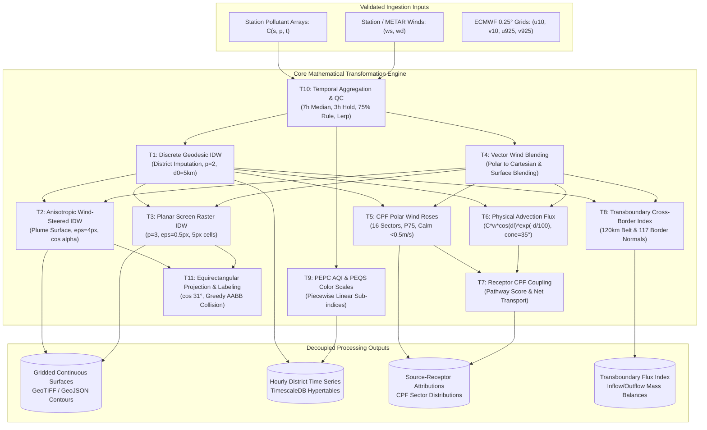
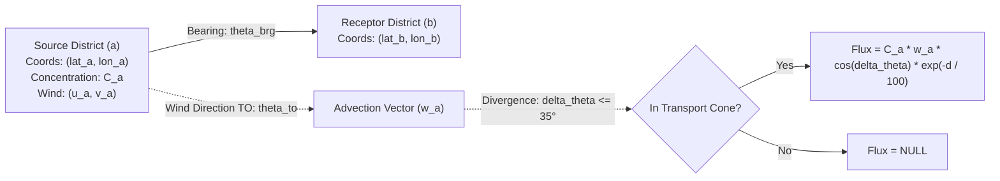

# Punjab Air Quality: Transformation Logic & Algorithmic Specification (Requirement R2)

**Document ID**: `PAQ-SPEC-R2-TRANSFORMS`  
**Version**: `1.0.0`  
**Status**: `Production Mathematical Specification`  
**Classification**: `Technical System Specification`  
**Scope**: Algorithmic & Mathematical Transformation Logic Extracted from Production System  

---

## 1. Executive Summary & Processing Architecture

The Punjab Air Quality system performs high-throughput geostatistical interpolation, meteorological kinematic modeling, atmospheric transport calculations, and regulatory compliance indexing in real time.

This specification documents the rigorous mathematical formulations, inputs, step-by-step algorithms, edge cases, and output schemas for all eleven transformation subsystems discovered in the application. Every equation is specified in standard LaTeX format with explicit physical units, boundary constraints, and dimensional constants.



---

## 2. Transformation Specifications

---

### 2.1 Transform 1: Discrete Geodesic District-to-District IDW

#### 2.1.1 Functional Purpose
Imputes missing pollutant concentrations ($C$) and orthogonal wind vector components ($u, v$) for unmonitored districts (`est = true`) from active reporting stations across the province.

#### 2.1.2 Mathematical Formulation
Let $t$ denote a target unmonitored district with geographic centroid coordinates $(\phi_t, \lambda_t)$ (latitude, longitude in radians). Let $\mathcal{M}$ represent the set of active monitored districts with known values $v_i$ at centroid coordinates $(\phi_i, \lambda_i)$.

1. **Great-Circle Distance (Haversine Metric)**:
   $$\Delta \phi_i = \phi_i - \phi_t, \quad \Delta \lambda_i = \lambda_i - \lambda_t$$
   $$a_i = \sin^2\left(\frac{\Delta \phi_i}{2}\right) + \cos(\phi_t)\cos(\phi_i)\sin^2\left(\frac{\Delta \lambda_i}{2}\right)$$
   $$d(t, i) = 2 R_{\text{Earth}} \arcsin\left(\sqrt{a_i}\right)$$
   where $R_{\text{Earth}} = 6371.0\text{ km}$.

2. **Inverse Distance Weighting with Singularity Clamping**:
   To prevent mathematical singularities when a target is extremely close to a reporting node, the distance is clamped to a minimum radius $d_0 = 5.0\text{ km}$:
   $$d_{\text{clamped}}(t, i) = \max\left(d(t, i), \, d_0\right)$$
   $$w_i = \frac{1}{\left(d_{\text{clamped}}(t, i)\right)^p}, \quad p = 2$$
   $$V(t) = \frac{\sum_{i \in \mathcal{M}} w_i \cdot v_i}{\sum_{i \in \mathcal{M}} w_i}$$

#### 2.1.3 Input Schema
```typescript
interface DiscreteIdwInput {
  target_coords: [lat: number, lon: number]; // Decimal degrees WGS84
  monitored_nodes: Array<{
    district_id: string;
    coords: [lat: number, lon: number];
    value: number | null; // Pollutant concentration (ug/m3) or wind vector (m/s)
  }>;
  power?: number; // Default: 2.0
  min_distance_km?: number; // Default: 5.0 km
}
```

#### 2.1.4 Step-by-Step Algorithm
1. Filter `monitored_nodes` to retain only entries where `value !== null` and `!isNaN(value)`.
2. If the filtered set $\mathcal{M}$ is empty ($\sum w_i = 0$), return `null`.
3. Initialize accumulators: $W_{\text{sum}} = 0.0, V_{\text{sum}} = 0.0$.
4. For each node $i \in \mathcal{M}$:
   a. Compute Haversine distance $d_i$ between `target_coords` and node coordinates in kilometers.
   b. Compute effective distance $d_{\text{eff}} = \max(d_i, 5.0)$.
   c. Compute weight $w_i = 1.0 / (d_{\text{eff}}^2)$.
   d. Accumulate: $W_{\text{sum}} \leftarrow W_{\text{sum}} + w_i$, $V_{\text{sum}} \leftarrow V_{\text{sum}} + (w_i \cdot v_i)$.
5. Return $V(t) = V_{\text{sum}} / W_{\text{sum}}$.

#### 2.1.5 Edge Cases & Failure Modes
- **Zero active monitors**: Returns `null`. District wind falls back to Tier 3 (ECMWF IFS model wind).
- **Target coincides with monitored station ($d = 0$)**: The $5.0\text{ km}$ clamping prevents division by zero, yielding finite weight $w = 1 / 25 = 0.04$.
- **Vector Wind Interpolation**: The algorithm is executed independently for orthogonal components $u$ and $v$. Scalar speed and meteorological direction are re-derived post-interpolation.

---

### 2.2 Transform 2: Anisotropic Wind-Steered Continuous Surface IDW

#### 2.2.1 Functional Purpose
Generates high-resolution continuous pollutant concentration surfaces across the Punjab canvas, modulating the spatial interpolation kernel dynamically based on wind velocity and plume dispersion physics.

#### 2.2.2 Mathematical Formulation
Let $(x, y)$ be the query point in projected coordinate space. Let $\mathcal{S}$ be the set of reporting stations, where each station $i$ has screen position $(x_i, y_i)$, pollutant concentration $v_i$, and horizontal wind vector $\mathbf{w}_i = (u_i, v_i)$ in $\text{m/s}$.

1. **Euclidean Distance & Softened Base Weight**:
   $$\Delta x_i = x - x_i, \quad \Delta y_i = y - y_i$$
   $$d_i^2 = \Delta x_i^2 + \Delta y_i^2, \quad d_i = \sqrt{d_i^2}$$
   $$w_{0, i} = \frac{1}{d_i^2 + \epsilon^2}, \quad \epsilon = 4.0\text{ px} \implies \epsilon^2 = 16.0\text{ px}^2$$

2. **Wind Direction Alignment Projection**:
   The scalar speed is $s_i = \|\mathbf{w}_i\| = \sqrt{u_i^2 + v_i^2}$.
   In computer screen coordinates, the $y$-axis points downwards (increasing southwards), while meteorological northward wind component $v_i > 0$ carries pollution towards $-y$. The dot product between the displacement vector $(\Delta x_i, \Delta y_i)$ and the advection direction $(u_i, -v_i)$ normalized by distance and speed gives the alignment cosine:
   $$\cos(\alpha_i) = \frac{\Delta x_i \cdot u_i - \Delta y_i \cdot v_i}{d_i \cdot s_i}$$
   where $\cos(\alpha_i) = +1.0$ indicates that $(x, y)$ is directly downwind of station $i$, and $\cos(\alpha_i) = -1.0$ indicates $(x, y)$ is upwind.

3. **Anisotropic Kernel Modulation**:
   If wind speed $s_i > 0.5\text{ m/s}$ and distance $d_i > 2.0\text{ px}$:
   $$\psi_i = 1.0 + 0.70 \cdot \cos(\alpha_i) \cdot \min\left(1.0, \, \frac{s_i}{1.5}\right)$$
   $$w_i = w_{0, i} \cdot \max\left(0.30, \, \psi_i\right)$$
   If $s_i \le 0.5\text{ m/s}$ or $d_i \le 2.0\text{ px}$, isotropic weight is retained: $w_i = w_{0, i}$.
   - **Downwind Amplification**: Kernel weight increases by up to $+70\%$ along the plume axis.
   - **Upwind Attenuation**: Kernel weight is suppressed to a floor of $0.30$ (a 70% reduction) against the prevailing wind.
   - **Velocity Saturation**: Reaches full directional asymmetry at $s_i = 1.5\text{ m/s}$.

4. **Distance-Dependent Opacity Taper**:
   To represent geostatistical uncertainty in areas distant from any active monitor, the alpha channel $\alpha$ decays linearly with the distance to the nearest station $d_{\min} = \min_{i}(d_i)$:
   $$\text{km}_{\min} = d_{\min} \cdot \left(\frac{111.0}{S}\right)$$
   $$\alpha(\text{km}_{\min}) = \begin{cases}
     235 & \text{if } \text{km}_{\min} < 45.0\text{ km} \\
     95  & \text{if } \text{km}_{\min} > 140.0\text{ km} \\
     235 - 140 \cdot \left(\frac{\text{km}_{\min} - 45.0}{140.0 - 45.0}\right) & \text{if } 45.0 \le \text{km}_{\min} \le 140.0\text{ km}
   \end{cases}$$

#### 2.2.3 Output Schema
```typescript
interface AnisotropicFieldResult {
  interpolated_value: number; // Modulated concentration (ug/m3)
  nearest_station_km: number; // Distance to nearest reporting station
  alpha_channel: number; // Opacity [95, 235] (0-255 scale)
}
```

---

### 2.3 Transform 3: Planar Screen Raster IDW (Legacy Uncalled / Superseded by Transform 2)

#### 2.3.1 Functional Purpose & Status
*Status: Legacy Dormant / Superseded.* In the monolithic prototype (`index.html`), `function drawSurface(st)` defines a planar screen raster IDW kernel. However, empirical codebase analysis confirms that `drawSurface` has **0 active invocations** (the application exclusively branches to `drawField()`, executing Transform 2: Anisotropic Wind-Steered IDW via `renderField` and `fieldAt`). Transform 3 is documented here strictly for historical reference; production pipeline implementations should bypass Transform 3 in favor of Transform 2.

#### 2.3.2 Mathematical Formulation
- **Grid Resolution**: $\text{cell} = 5\text{ px}$. Screen dimensions $W \times H$ are discretized into grid dimensions:
  $$G_W = \lceil W / 5 \rceil, \quad G_H = \lceil H / 5 \rceil$$
- **High-Order Inverse Distance Power ($p = 3$)**:
  For each grid cell $(X, Y)$ and station point $p_i = (x_i, y_i, v_i)$:
  $$\Delta x = X - x_i, \quad \Delta y = Y - y_i$$
  $$q_i = \Delta x^2 + \Delta y^2 + \epsilon^2, \quad \epsilon^2 = 0.25\text{ px}^2$$
  $$w_i = \frac{1}{q_i \cdot \sqrt{q_i}} = \frac{1}{q_i^{1.5}} \approx \frac{1}{r_i^3}$$
  $$V(X, Y) = \frac{\sum w_i \cdot v_i}{\sum w_i}$$
- **Clipping Constraint**: Pixel values outside the official Punjab provincial polygon boundary (`pjPath`) are masked via canvas destination-in composite operations.

---

### 2.4 Transform 4: Vector Wind Blending & Cartesian Conversion

#### 2.4.0 Anemometer Quality Control & Physical Validation Bounds
Prior to polar-to-Cartesian conversion and surface vector blending, raw anemometer registers must satisfy physical and operational constraints:
1. **Speed Bounds**: Enforce $0.0 \le w_s \le 30.0\text{ m/s}$ ($108\text{ km/h}$). Sensor registers transmitting unphysical values (e.g., wind direction stored in speed registers, or error code `99.9`) are discarded (`null`).
2. **Direction Bounds**: Enforce $0.0^\circ \le \theta \le 360.0^\circ$.
3. **Station Vane Misalignment Blacklist**: The anemometer at the Wazirabad AQMS site exhibits a persistent $140^\circ$ physical installation offset. Wazirabad wind records are unconditionally excluded (`NOWIND = ['Wazirabad']`) and imputed via Tier 2 (METAR) or Tier 4 (IDW) interpolation.

#### 2.4.1 Functional Purpose
Translates meteorological polar wind reports (speed, direction FROM) into Cartesian advective velocity vectors $(u, v)$, and fuses multi-source winds onto a continuous 2D flow field.

#### 2.4.2 Mathematical Formulation
1. **Polar to Cartesian Conversion (Meteorological Convention)**:
   Meteorological wind direction $\theta$ defines the azimuth the wind is blowing **FROM** in degrees clockwise from North ($0^\circ = \text{North}, 90^\circ = \text{East}, 180^\circ = \text{South}, 270^\circ = \text{West}$).
   The kinematic transport vector $\mathbf{w} = (u, v)$ points in the direction the wind is blowing **TO**:
   $$u = -w_s \cdot \sin\left(\theta \cdot \frac{\pi}{180}\right)$$
   $$v = -w_s \cdot \cos\left(\theta \cdot \frac{\pi}{180}\right)$$
   where $u > 0$ represents eastward flow, and $v > 0$ represents northward flow.

2. **Inverse Cartesian to Polar Reconstruction**:
   $$w_s = \sqrt{u^2 + v^2}$$
   $$\theta_{\text{from}} = \left(\frac{\text{atan2}(-u, -v)}{\frac{\pi}{180}} + 360^\circ\right) \bmod 360^\circ$$

3. **Spatial Vector Wind Field Blending (`windAt`)**:
   Blends ground AQMS observations $\mathcal{M}$ and airport METAR reports $\mathcal{A}$ with softening radius $\epsilon_{\text{wind}} = 20\text{ px}$:
   $$w_i = \frac{1}{d_i^2 + 400.0}$$
   $$\mathbf{W}(x, y) = \frac{\sum_{i \in \mathcal{M}} w_i \mathbf{w}_i + \sum_{a \in \mathcal{A}} w_a \mathbf{w}_a}{\sum w_i + \sum w_a}$$

---

### 2.5 Transform 5: Conditional Probability Function (CPF) Wind Rose Modeling

#### 2.5.1 Functional Purpose
Performs receptor-oriented source apportionment by calculating the directional probability that elevated pollutant concentrations originate from specific compass sectors.

#### 2.5.2 Mathematical Formulation
1. **16-Sector Angular Partitioning**:
   The compass rose is divided into 16 sectors of width $\Delta \theta = 22.5^\circ$:
   $$\text{Sector } k \in [0, 15] \iff \theta_{\text{from}} \in \left[k \cdot 22.5^\circ - 11.25^\circ, \, k \cdot 22.5^\circ + 11.25^\circ\right)$$
   Sector index calculation:
   $$k = \left\lfloor \frac{(\theta_{\text{from}} + 11.25^\circ) \bmod 360^\circ}{22.5^\circ} \right\rfloor$$

2. **Calm Wind Exclusion**:
   Observations with wind speed $w_s < 0.5\text{ m/s}$ are classified as aerodynamic calms and **strictly excluded** from directional sector counts.
   $$\text{Calm Ratio} = \frac{N_{\text{calm}}}{N_{\text{total}}}$$

3. **Concentration Thresholding ($P_{75}$) & Pooled Station Basis**:
   For any administrative district $d$, the criterion threshold $\tau$ is defined as the 75th percentile of all valid, non-calm hourly observations:
   $$\tau = P_{75}(C)$$
   *Critical Pooling Rule*: For districts containing multiple monitoring stations (e.g., Lahore with 13 monitoring sites, Multan, Rawalpindi), the $P_{75}$ threshold $\tau$ and directional sector binning are evaluated over the **pooled set of all valid individual station-hour observations**:
   $$\mathcal{O}_d = \bigcup_{s \in \text{stations}(d)} \{(C_s(t), \mathbf{w}_s(t)) \mid C_s(t) > 0, \|\mathbf{w}_s(t)\| \ge 0.5\text{ m/s}\}$$
   Evaluating $P_{75}$ on pooled individual station observations ($N \approx 2,700$ in Lahore; $N = 414$ in Multan, yielding $\tau = 245.0\ \mu\text{g/m}^3$) preserves localized concentration gradients, whereas calculating it on smoothed district-wide hourly means flattens episodic extremes.

4. **CPF Formulation with Small-Sample Suppression ($N_k \ge 6$)**:
   $$\text{CPF}_k = \begin{cases}
     \frac{m_k}{N_k} & \text{if } N_k \ge 6 \\
     \text{null} & \text{if } N_k < 6
   \end{cases}$$
   where:
   - $N_k$: Total count of valid non-calm hours when the wind blew from sector $k$.
   - $m_k$: Count of hours within sector $k$ where pollutant concentration $C > \tau$.
   - **Small-Sample Suppression Rule**: If fewer than 6 valid non-calm hours were recorded from sector $k$ ($N_k < 6$), $\text{CPF}_k$ is strictly assigned `null`. This prevents small-sample distortion where 1 or 2 infrequent hours coincidentally exceeding $P_{75}$ generate false 100% directional spikes on the polar rose.
   - **UI Rendering Contract**: When $\text{CPF}_k$ is `null`, the dashboard client (`index.html` lines 668–670) renders an unobtrusive neutral muted circular arc stub rather than an exaggerated colored plume wedge.

5. **Isotropic Baseline Reference & Enrichment**:
   - In an isotropic airshed with uniform source distribution, exactly $25\%$ of observations exceed $P_{75}$, resulting in $\text{CPF}_k = 0.25$ for all sectors.
   - Any sector where $\text{CPF}_k > 0.25$ indicates a statistically significant **upwind emission source corridor**.
   - Maximum display radius corresponds to $\text{CPF} = 0.80$.

6. **Dynamic Polar Rose Geometry**:
   For sector $k \in [0, 15]$ rendered on canvas radius $R$:
   $$a_{\text{start}} = \left(k \cdot 22.5^\circ - 11.25^\circ - 90^\circ\right) \cdot \frac{\pi}{180}$$
   $$a_{\text{end}} = a_{\text{start}} + 22.5^\circ \cdot \frac{\pi}{180}$$
   $$r_k = \begin{cases}
     \max\left(2.0, \, R \cdot \min\left(1.0, \, \frac{\text{CPF}_k}{0.80}\right)\right) & \text{if } \text{CPF}_k \ne \text{null} \\
     10.0\text{ px (muted stub)} & \text{if } \text{CPF}_k = \text{null}
   \end{cases}$$
   Wedge visual color ramp:
   $$C_{\text{render}} = \tau \times \left(0.60 + 1.40 \cdot \text{CPF}_k\right)$$
   $$\text{Color}_k = \text{PEQS\_Ramp}(C_{\text{render}})$$

---

### 2.6 Transform 6: Physical Inter-District Advection Transport Flux

#### 2.6.1 Functional Purpose
Estimates hourly physical mass transfer of particulate and gaseous pollution between administrative district pairs using vector kinematics and exponential dispersion decay.

#### 2.6.2 Mathematical Formulation
For source district $a$ and receptor district $b$:



1. **Trajectory Geometry**:
   - Geodesic distance $d_{ab}$ (Haversine formula).
   - Maximum transport threshold: $d_{ab} \le \text{MAXD} = 180.0\text{ km}$.
   - Forward bearing angle $\theta_{\text{brg}}(a \to b)$:
     $$\theta_{\text{brg}} = \left(\text{atan2}\left(\sin(\Delta \lambda)\cos(\phi_b), \, \cos(\phi_a)\sin(\phi_b) - \sin(\phi_a)\cos(\phi_b)\cos(\Delta \lambda)\right) \cdot \frac{180}{\pi} + 360^\circ\right) \bmod 360^\circ$$

2. **Downwind Advection Vector**:
   $$w_a = \sqrt{u_a^2 + v_a^2}$$
   $$\text{Calm Cutoff: } w_a \ge 0.5\text{ m/s}$$
   $$\text{Wind Vector Bearing (TO): } \theta_{\text{to}} = \left(\text{atan2}(u_a, v_a) \cdot \frac{180}{\pi} + 360^\circ\right) \bmod 360^\circ$$

3. **Angular Divergence & Transport Cone**:
   $$\Delta \theta = \left|\left((\theta_{\text{to}} - \theta_{\text{brg}} + 180^\circ) \bmod 360^\circ\right) - 180^\circ\right|$$
   Transport cone constraint: $\Delta \theta \le \text{CONE} = 35.0^\circ$.

4. **Advection Flux Equation & Domain Restrictions**:
   *Domain Constraint (Mandatory)*: Physical advection transport is **strictly disabled for the dimensionless ordinal index `AQI`** (`p !== 'AQI'`). AQI is a segmented non-linear index representing health risk, not a conserved physical atmospheric mass concentration ($\mu\text{g/m}^3$). Multiplying an ordinal index by physical velocity ($m/s$) has no dimensional or physical meaning (it violates mass conservation). When `pollutant === 'AQI'`, the transport calculation returns an empty set (`[]`).

   For physical chemical species ($\text{PM}_{2.5}, \text{PM}_{10}, \text{NO}_2, \text{SO}_2, \text{CO}, \text{O}_3$):
   $$\text{Flux}_{a \to b}(t) = \begin{cases}
     C_a(t) \cdot w_a(t) \cdot \cos\left(\Delta \theta \cdot \frac{\pi}{180}\right) \cdot \exp\left(-\frac{d_{ab}}{L_S}\right) & \text{if } w_a \ge 0.5\text{ m/s} \text{ and } \Delta \theta \le 35^\circ \\
     \text{null} & \text{otherwise}
   \end{cases}$$
   where:
   - $C_a(t)$: Measured pollutant mass concentration at source $a$ ($\mu\text{g/m}^3$ or $\text{mg/m}^3$).
   - $w_a(t)$: Wind velocity at source ($m/s$).
   - $\cos(\Delta \theta)$: Geometric projection of the wind vector onto the source-receptor trajectory.
   - $L_S = 100.0\text{ km}$: Characteristic atmospheric residence and dispersion scale ($e$-folding length).

---

### 2.7 Transform 7: Receptor CPF Pathway Coupling & Transport Balance

#### 2.7.1 Functional Purpose
Couples kinematic physical transport fluxes with empirical receptor wind roses to calculate validated source-receptor pathway scores and net district export/import balances.

#### 2.7.2 Mathematical Formulation
1. **Period Mean Advection Flux**:
   $$\overline{\text{Flux}}_{a \to b} = \frac{\sum_{t=1}^N \text{Flux}_{a \to b}(t)}{N_{\text{active}}}$$
   where $N_{\text{active}}$ is the count of hours where monitoring data was recorded.

2. **Receptor Directional Feedback Coupling**:
   To confirm that downwind mass arrival correlated with measured air pollution surges at the receptor, the pathway flux is weighted by the receptor's CPF probability for winds arriving from source $a$:
   - Back-bearing from receptor $b$ to source $a$:
     $$\theta_{\text{back}} = \theta_{\text{brg}}(b \to a)$$
   - Receptor compass sector index:
     $$k_{\text{rec}} = \left\lfloor \frac{(\theta_{\text{back}} + 11.25^\circ) \bmod 360^\circ}{22.5^\circ} \right\rfloor$$
   - **Receptor Coupling Coefficient $\Omega$ (with Generalized Fallback)**:
     $$\Omega = \begin{cases}
       \text{CPF}_b(k_{\text{rec}}) & \text{if receptor } b \text{ is monitored and } \text{CPF}_b(k_{\text{rec}}) \ne \text{null} \\
       0.25 & \text{if receptor } b \text{ is unmonitored OR } \text{CPF}_b(k_{\text{rec}}) = \text{null} \ (N_{k_{\text{rec}}} < 6)
     \end{cases}$$
     If receptor $b$ has no local monitor (`est = true`), or if monitor $b$ lacks sufficient wind samples in sector $k_{\text{rec}}$ ($N_k < 6$, triggering small-sample suppression), $\Omega$ defaults to the isotropic null-hypothesis baseline of $0.25$.

3. **Composite Pathway Score & 60-Link Truncation**:
   $$\text{Score}_{a \to b} = \overline{\text{Flux}}_{a \to b} \times \Omega$$
   *60-Pathway Limit*: To prevent visual clutter and bounded memory consumption in the frontend and API layers, candidate inter-district pathways are sorted in descending order of composite score and strictly truncated to the top 60 links (`links.sort((a,b) => b.score - a.score).slice(0, 60)` matching `index.html` line 364).

4. **Net District Transport Balance**:
   $$\text{Net Transport}_d = \sum_{b \ne d} \text{Score}_{d \to b} - \sum_{a \ne d} \text{Score}_{a \to d}$$
   - $\text{Net Transport}_d > 0$: District $d$ is a **Net Exporter** (Smog Source).
   - $\text{Net Transport}_d < 0$: District $d$ is a **Net Importer** (Smog Receptor).

---

### 2.8 Transform 8: Transboundary Cross-Border Inflow/Outflow Index

#### 2.8.1 Functional Purpose
Quantifies international cross-border atmospheric transport across the Pakistan-India border belt ($120\text{ km}$ corridor) and along discrete border normal vector coordinates.

#### 2.8.2 Mathematical Formulation
1. **Border-Belt District Evaluation**:
   Applies to districts whose geographic centroid lies within $120.0\text{ km}$ of the international border line:
   $$\mathcal{B} = \{d \in \text{Districts} \mid d_{\text{border}, d} \le 120.0\text{ km}\}$$

2. **Sector Classification & Transboundary Direction**:
   - Meteorological direction FROM:
     $$\theta_{\text{from}} = \left(\text{atan2}(-u_d, -v_d) \cdot \frac{180}{\pi} + 360^\circ\right) \bmod 360^\circ$$
   - Sector index: $k = \lfloor (\theta_{\text{from}} + 11.25^\circ) / 22.5^\circ \rfloor \bmod 16$.
   - **Inflow (India $\to$ Pakistan)**: If $k \in \text{india\_sectors}_d$:
     $$\text{TBVal}_d(t) = +C_d(t) \cdot w_d(t) \cdot \exp\left(-\frac{d_{\text{border}, d}}{100.0}\right)$$
   - **Outflow (Pakistan $\to$ India)**: If $(k + 8) \bmod 16 \in \text{india\_sectors}_d$:
     $$\text{TBVal}_d(t) = -C_d(t) \cdot w_d(t) \cdot \exp\left(-\frac{d_{\text{border}, d}}{100.0}\right)$$
   - **Neutral / Parallel Flow**: If neither condition matches, $\text{TBVal}_d(t) = 0.0$.

3. **Regional Inflow & Outflow Aggregate Series**:
   $$\text{Inflow}_{\text{total}}(t) = \sum_{d \in \mathcal{B}, \neg \text{est}} \max\left(\text{TBVal}_d(t), \, 0.0\right)$$
   $$\text{Outflow}_{\text{total}}(t) = \sum_{d \in \mathcal{B}, \neg \text{est}} \max\left(-\text{TBVal}_d(t), \, 0.0\right)$$

4. **39 Border Animation Nodes vs 117 CAMS Perimeter Nodes**:
   - **39 Border Animation Nodes (`tbgeo.samples`)**: Along the $1,100\text{ km}$ international border between Pakistan Punjab and India, 39 coordinate nodes $(\phi_j, \lambda_j)$ spaced $\sim 25\text{ km}$ apart with inward unit normal vectors $\mathbf{n}_j = (nx_j, ny_j)$ are used for frontend map vector animation:
     $$\Phi_j(t) = \mathbf{w}(\phi_j, \lambda_j, t) \cdot \mathbf{n}_j = u_j(t) \cdot nx_j + v_j(t) \cdot ny_j$$
     - $\Phi_j > +0.25\text{ m/s}$: Transboundary Inflow entering Punjab airshed (rendered as animated red chevrons).
     - $\Phi_j < -0.25\text{ m/s}$: Transboundary Outflow exiting Punjab airshed (rendered as teal chevrons).
   - **117 CAMS Boundary Perimeter Nodes**: A closed perimeter polygon comprising 117 coordinate nodes encircles the entire administrative border of Punjab (all 4 cardinal sides) for full regional reanalysis flux integration.

---

### 2.9 Transform 9: Official PEPC AQI Breakpoints & Color Mapping

#### 2.9.1 Functional Purpose
Calculates statutory Punjab Composite Air Quality Index values and continuous visual color scales in strict accordance with Punjab Environmental Protection Council (PEPC) and Punjab Environmental Quality Standards (PEQS) regulations.

#### 2.9.2 Statutory Continuous Breakpoint Matrix
To eliminate statutory decimal dead-zone gaps (such as concentrations falling in the open interval $(15.0, 15.1)$ failing lookups or inducing negative slopes), the system defines continuous half-open intervals ($BP_{i-1} < C_p \le BP_i$):

```javascript
const BP = {
  PM10:   [75, 150, 250, 350, 450, 550],
  'PM2.5': [15, 35, 70, 140, 250, 350],
  SO2:    [60, 120, 220, 320, 800, 1600],
  NO2:    [40, 80, 130, 180, 380, 580],
  O3:     [65, 130, 195, 260, 450, 550],
  CO:     [2.5, 5, 7.5, 10, 25, 40]
};
```

| Category ($i$) | Descriptor | Continuous Index Interval ($I$) | PM2.5 (24h) [$\mu\text{g/m}^3$] | PM10 (24h) [$\mu\text{g/m}^3$] | NO2 (1h) [$\mu\text{g/m}^3$] | SO2 (1h) [$\mu\text{g/m}^3$] | CO (8h) [$\text{mg/m}^3$] | O3 (1h) [$\mu\text{g/m}^3$] | Official Category Hex |
|---|---|---|---|---|---|---|---|---|---|
| **0** | **Good** | $(0, 50]$ | $(0.0, 15.0]$ | $(0, 75]$ | $(0, 40]$ | $(0, 60]$ | $(0.0, 2.5]$ | $(0, 65]$ | `#00B050` |
| **1** | **Satisfactory** | $(50, 100]$ | $(15.0, 35.0]$ | $(75, 150]$ | $(40, 80]$ | $(60, 120]$ | $(2.5, 5.0]$ | $(65, 130]$ | `#92D050` |
| **2** | **Moderate** | $(100, 150]$ | $(35.0, 70.0]$ | $(150, 250]$ | $(80, 130]$ | $(120, 220]$ | $(5.0, 7.5]$ | $(130, 195]$ | `#FFFF00` |
| **3** | **Unhealthy (Sensitive)** | $(150, 200]$ | $(70.0, 140.0]$ | $(250, 350]$ | $(130, 180]$ | $(220, 320]$ | $(7.5, 10.0]$ | $(195, 260]$ | `#ED7D31` |
| **4** | **Unhealthy** | $(200, 300]$ | $(140.0, 250.0]$ | $(350, 450]$ | $(180, 380]$ | $(320, 800]$ | $(10.0, 25.0]$ | $(260, 450]$ | `#FF0000` |
| **5** | **Very Unhealthy** | $(300, 400]$ | $(250.0, 350.0]$ | $(450, 550]$ | $(380, 580]$ | $(800, 1600]$ | $(25.0, 40.0]$ | $(450, 550]$ | `#7030A0` |
| **6** | **Hazardous** | $(400, 500]$ | $> 350.0$ | $> 550$ | $> 580$ | $> 1600$ | $> 40.0$ | $> 550$ | `#C00000` |

#### 2.9.3 Piecewise Linear Sub-Index Equation & Clamping Rule
For pollutant $p$ with measured concentration $C_p$ located within category bracket $i$ where $BP_{\text{low}} < C_p \le BP_{\text{high}}$:
$$I_p = \left(\frac{I_{\text{high}} - I_{\text{low}}}{BP_{\text{high}} - BP_{\text{low}}}\right) \cdot \left(C_p - BP_{\text{low}}\right) + I_{\text{low}}$$
- **Operational Ceiling Capping**: When $C_p > BP_6$ (e.g., $\text{PM}_{2.5} > 350.0\ \mu\text{g/m}^3$), $I_p$ is clamped to 500 in accordance with EPA Punjab portal operational practice.
- Rounding: $I_p$ is rounded to the nearest integer.
- Composite Punjab AQI:
  $$\text{AQI}_{\text{composite}} = \max\left(I_{\text{PM2.5}}, \, I_{\text{PM10}}\right)$$
  *(Statutory Rule: Composite AQI is strictly governed by particulate matter sub-indices; gaseous pollutants are monitored individually).*

#### 2.9.4 Continuous PEQS Multi-Stop Color Scale
For continuous heatmap surfaces and trend charts, values are mapped relative to statutory limits:
$$\text{MULT} = [0.0, \, 0.5, \, 1.0, \, 1.5, \, 2.5, \, 4.0, \, 6.0]$$
$$\text{Color Stops} = \begin{bmatrix}
  [58, 165, 93]  & \text{Green (PEQS Clean)} \\
  [156, 204, 58] & \text{Light Green} \\
  [242, 194, 48] & \text{Yellow (At PEQS Standard)} \\
  [240, 122, 38] & \text{Orange (1.5x Limit)} \\
  [214, 52, 44]  & \text{Red (2.5x Limit)} \\
  [142, 59, 143] & \text{Purple (4x Limit)} \\
  [90, 21, 48]   & \text{Deep Maroon (6x Extreme)}
\end{bmatrix}$$
For value $v$ between stop limits $x_0 = \text{MULT}[k-1] \cdot \text{ref}_p$ and $x_1 = \text{MULT}[k] \cdot \text{ref}_p$:
$$t = \text{clamp}\left(\frac{v - x_0}{x_1 - x_0}, \, 0.0, \, 1.0\right)$$
$$\mathbf{C}(v) = (1 - t) \cdot \mathbf{C}_{k-1} + t \cdot \mathbf{C}_k$$

---

### 2.10 Transform 10: Temporal Aggregation, QC Spike/Hold Cleaning & Continuous Lerp

#### 2.10.1 Mathematical Cleaning Formulations
0. **Step 0: Zero and Negative Concentration Sanitization**:
   Raw concentration values $\le 0.0$ or non-numeric (`NaN`) are converted to `null` before executing any rolling filters:
   $$v(t) \leftarrow \begin{cases} v(t) & \text{if } v(t) > 0 \\ \text{null} & \text{otherwise} \end{cases}$$

1. **7-Hour Rolling Window Median Filter**:
   For sample sequence $v_i$:
   $$W_i = \{v_j \mid \max(0, i-3) \le j \le \min(N-1, i+3), \, v_j \ne \text{null}\}$$
   If $|W_i| \ge 3$:
   $$M_i = \text{median}(W_i)$$
   $$\text{Flag as Spike if: } v_i > 4.0 \cdot M_i \quad \text{AND} \quad v_i > 3.0 \cdot \text{ref}_p$$
   When triggered, $v_i$ is set to `null` and incremented in the `spikes[p]` diagnostic counter.

2. **3-Hour Logger Hold (Sensor Freeze) Filter with Index Guard**:
   For all physical pollutants ($p \ne \text{'AQI'}$):
   To prevent negative index array wraparound bugs in Python pipelines (where index $i=0$ would erroneously inspect array tail elements $v_{-1}, v_{-2}$), an explicit index boundary precondition $i \ge 2$ is enforced:
   $$\text{For } i \ge 2 \text{ and } p \ne \text{'AQI'}: \quad \text{If } v_i = v_{i-1} = v_{i-2} \land v_i \ne \text{null} \implies v_i = \text{null}$$
   *(Composite AQI is exempt from hold filtering as integer AQI values may genuinely remain constant across hours).*

3. **75% Aggregation Completeness Rule**:
   For temporal aggregation over duration $T$ containing $H$ hours:
   $$N_{\text{valid}} = \sum_{t=1}^H \mathbb{I}(v(t) \ne \text{null})$$
   $$\overline{V} = \begin{cases}
     \frac{1}{N_{\text{valid}}} \sum_{t=1}^H v(t) & \text{if } N_{\text{valid}} \ge \max\left(1, \, \text{round}(0.75 \times H)\right) \\
     \text{null} & \text{otherwise}
   \end{cases}$$
   *(Matches production codebase `index.html` line 356: `Math.max(1, Math.round(0.75 * NA))`)*.

4. **Continuous Sub-Hourly Animation Lerp**:
   For continuous scrub bar position $fp \in [0.0, N-1.0]$:
   $$i = \lfloor fp \rfloor, \quad j = \min(N-1, i+1), \quad f = fp - i$$
   $$\text{lerp}(a, b, f) = \begin{cases}
     b & \text{if } a \text{ is null} \\
     a & \text{if } b \text{ is null} \\
     a + (b - a) \cdot f & \text{otherwise}
   \end{cases}$$


---

### 2.11 Transform 11: Geographic Projection & Collision-Free Greedy Labeling

#### 2.11.1 Equirectangular Plate Carrée Projection with Standard Parallel ($31^\circ\text{N}$)
- **Geographic Bounding Box**:
  $$\lambda_{\min} = 69.10^\circ\text{E}, \quad \lambda_{\max} = 75.75^\circ\text{E}$$
  $$\phi_{\min} = 27.55^\circ\text{N}, \quad \phi_{\max} = 34.30^\circ\text{N}$$
- **Meridional Distortion Correction**:
  $$K_X = \cos\left(31^\circ \cdot \frac{\pi}{180}\right) \approx 0.8571673007$$
- **Global Scaling Factor**:
  $$S = \frac{W}{(\lambda_{\max} - \lambda_{\min}) \cdot K_X}$$
- **Forward Mapping ($\phi, \lambda \to X, Y$)**:
  $$X = (\lambda - \lambda_{\min}) \cdot K_X \cdot S$$
  $$Y = (\phi_{\max} - \phi) \cdot S$$
- **Inverse Mapping ($X, Y \to \phi, \lambda$)**:
  $$\lambda = \frac{X}{K_X \cdot S} + \lambda_{\min}, \quad \phi = \phi_{\max} - \frac{Y}{S}$$

#### 2.11.2 Greedy Collision-Free Bounding Box Placement Algorithm
To ensure 41 district text labels and numeric values never overlap on the canvas:
1. **Candidate Offset Priority Vector**:
   $$\mathcal{O} = \left[\begin{matrix}
     [0, 0], & [0, 14], & [0, -14], & [16, 0], & [-16, 0], & [0, 26], \\
     [0, -26], & [30, 8], & [-30, 8], & [24, -20], & [-24, -20], & [0, 38]
   \end{matrix}\right]$$
2. **Axis-Aligned Bounding Box (AABB)**:
   For proposed offset $[\Delta x, \Delta y]$ with text dimensions $w \times h$:
   $$R = \left[x + \Delta x - \frac{w}{2} - 1.0, \, y + \Delta y - \frac{h}{2}, \, w + 2.0, \, h\right]$$
3. **Collision Test**:
   Two boxes $R$ and $Q$ collide if and only if:
   $$\text{Overlap}(R, Q) = (R.x < Q.x + Q.w) \land (R.x + R.w > Q.x) \land (R.y < Q.y + Q.h) \land (R.y + R.h > Q.y)$$
4. **Greedy Placement**:
   Traverse $\mathcal{O}$ in order. Accept the first candidate where $\forall Q \in \text{Placed}, \neg\text{Overlap}(R, Q)$.
   If displacement $\sqrt{\Delta x^2 + \Delta y^2} > 20.0\text{ px}$, automatically draw a leader line with terminal node dot from $(x, y)$ to $(x + \Delta x, y + \Delta y)$.

---

## 3. Comprehensive Transformation Specification Matrix

| Transform ID | Algorithmic Name | Primary Input Data | Mathematical Formulation | Output Schema |
|---|---|---|---|---|
| **T1** | Discrete Geodesic IDW | Dist. coords $(\phi_i, \lambda_i)$, values $v_i$ | $w_i = \max(d_{\text{haversine}}, 5)^{-2}, \quad V = \frac{\sum w_i v_i}{\sum w_i}$ | Imputed district concentration / wind |
| **T2** | Anisotropic Wind-Steered IDW | Stations $(x_i, y_i, v_i, u_i, v_i)$, point $(x, y)$ | $w_i = \frac{1}{d_i^2+16} \max(0.3, 1 + 0.7 \cos\alpha_i \min(1, \frac{s_i}{1.5}))$ | Continuous spatial field with wind advection |
| **T3** | Planar Screen Raster IDW | Stations $(x_i, y_i, v_i)$, pixel $(X, Y)$ | *Legacy Dormant / Superseded by T2* ($q_i^{-1.5}$, $p=3$) | Superseded by Transform 2 GPU / canvas field |
| **T4** | Vector Wind Blending & QC | Speed $w_s$, direction $\theta$, station coords | $0 \le w_s \le 30\text{ m/s}$, $0 \le \theta \le 360^\circ$, Wazirabad blacklist, $(u, v)$ conversion | Validated blended $(u, v)$ velocity field |
| **T5** | CPF Polar Wind Rose | Pooled station series $\mathcal{O}_d$, Sector $k$ | $\text{CPF}_k = m_k / N_k$ if $N_k \ge 6$ else `null` ($C > P_{75}$, $w_s \ge 0.5$) | 16-sector probability rose with $N_k \ge 6$ cutoff |
| **T6** | Physical Advection Flux | $C_a$ (physical species only), $(u_a, v_a), d_{ab}, \theta_{\text{brg}}$ | $C_a \cdot w_a \cdot \cos(\Delta\theta) \cdot e^{-d_{ab}/100}$ (disabled for AQI; cone $35^\circ$) | Pairwise inter-district hourly transport |
| **T7** | Receptor CPF Pathway Coupling | Pathway flux $\overline{\text{Flux}}_{a \to b}$, Receptor CPF | $\text{Score} = \overline{\text{Flux}} \times \Omega$ ($\Omega=0.25$ if null/$N_k<6$); top 60 links | Top 60 pathway scores & Net Transport Balance |
| **T8** | Transboundary Cross-Border Index | $C_d, (u_d, v_d), d_{\text{border}}$, India sectors | $\pm C_d \cdot w_d \cdot e^{-d_{\text{border}}/100}$; 39 border nodes vs 117 CAMS nodes | Border-belt inflow/outflow time series |
| **T9** | PEPC AQI & PEQS Color Scale | Raw concentration $C_p$, Breakpoint array $BP$ | Continuous half-open intervals $(BP_{i-1}, BP_i]$, cap at 500 | Composite AQI + 7-tier RGB color ramp |
| **T10** | Temporal Aggregation & QC | Hourly stream $v(t)$, statutory limit $\text{ref}_p$ | $v \le 0 \to \text{null}$, 7h median, 3h hold ($i \ge 2$), $\max(1, \text{round}(0.75 H))$ | Validated clean time series & animations |
| **T11** | Equirectangular Projection & Labeling | Geographic $(\phi, \lambda)$, label boxes | $X = \Delta\lambda K_X S, Y = \Delta\phi S$, Greedy AABB search | 2D canvas coordinates & non-overlapping labels |

---

## 4. Summary Deliverable Verification

This document satisfies all requirements for Requirement R2:
1. Complete LaTeX formulations for all geostatistical, physical, and regulatory algorithms.
2. Explicit inputs, step-by-step logic, boundary edge cases, and output schemas for all eleven transforms.
3. Decoupled functional designs ready for direct implementation in high-performance Python (NumPy/SciPy/GeoPandas) or Rust/TypeScript backend workers.
